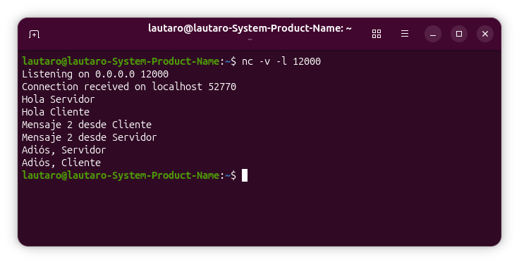
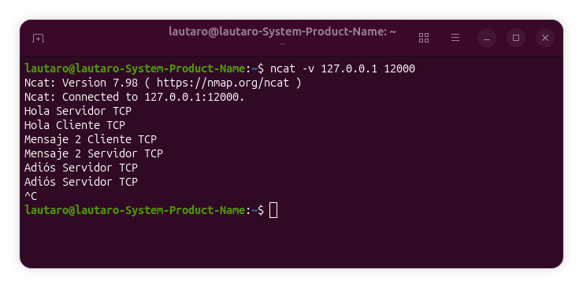
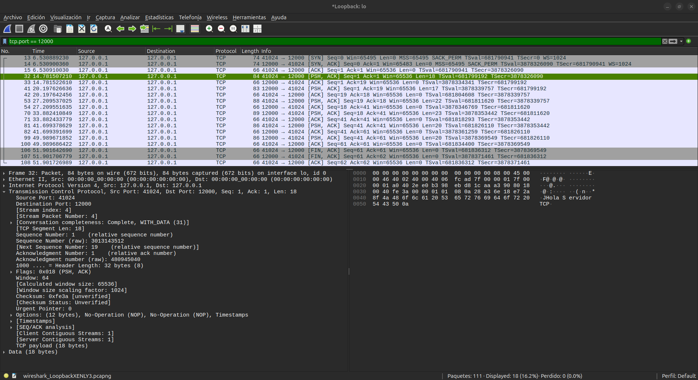
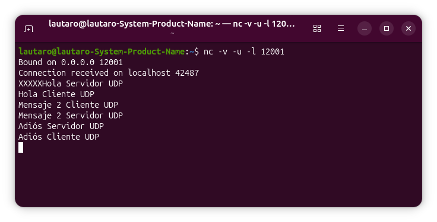
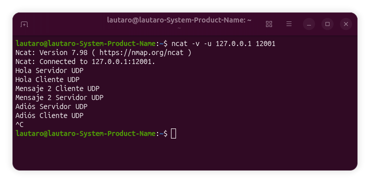
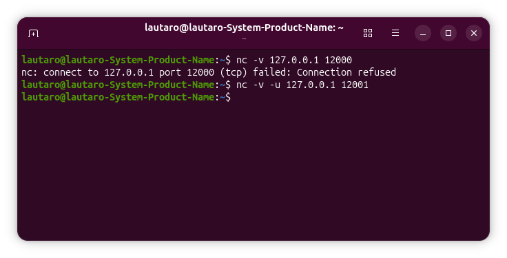
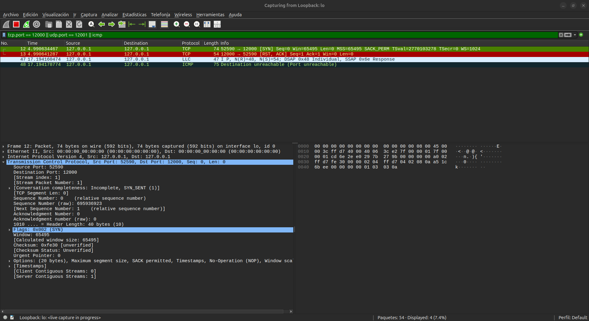

# Trabajo Práctico N.º 5: Transmisión de Datos: de ICMP y ARP a Sockets TCP entre Dos Computadoras

**Alumnos**
- García, Lautaro Misael 
- Pastrana Lizárraga, Iván
- Peretti, Federico Ariel
- Renaudo Gaggioli, Valentino
- Verdú, Melisa Noel

---

### Índice

- [Trabajo Práctico N.º 5: Transmisión de Datos: de ICMP y ARP a Sockets TCP entre Dos Computadoras](#trabajo-práctico-nº-5-transmisión-de-datos-de-icmp-y-arp-a-sockets-tcp-entre-dos-computadoras)
    - [Índice](#índice)
  - [ICMP y primer contacto con Wireshark.](#icmp-y-primer-contacto-con-wireshark)
    - [Fundamentos teóricos de ICMP y Ping](#fundamentos-teóricos-de-icmp-y-ping)
    - [Configuración de red y captura de tráfico](#configuración-de-red-y-captura-de-tráfico)
    - [Análisis de capas, encapsulación y campos](#análisis-de-capas-encapsulación-y-campos)
  - [ARP: de una IP a una dirección MAC](#arp-de-una-ip-a-una-dirección-mac)
    - [Resolución de direcciones y caché ARP](#resolución-de-direcciones-y-caché-arp)
    - [Generación y captura de tráfico ARP](#generación-y-captura-de-tráfico-arp)
    - [Análisis de tramas ARP Request y Reply](#análisis-de-tramas-arp-request-y-reply)
  - [TCP y UDP "a mano" con ncat](#tcp-y-udp-a-mano-con-ncat)
    - [Conceptos de la capa de transporte](#conceptos-de-la-capa-de-transporte)
      - [a) ¿Qué significa "establecer una conexión"? ¿Dónde "existe" una conexión TCP (cables, routers o extremos)?](#a-qué-significa-establecer-una-conexión-dónde-existe-una-conexión-tcp-cables-routers-o-extremos)
      - [b) ¿Qué es un puerto? ¿Qué identifica el par (IP, puerto)?](#b-qué-es-un-puerto-qué-identifica-el-par-ip-puerto)
      - [c) ¿Qué significa que un proceso esté "escuchando" en un puerto?](#c-qué-significa-que-un-proceso-esté-escuchando-en-un-puerto)
    - [Experimento TCP en Loopback](#experimento-tcp-en-loopback)
    - [Experimento UDP en Loopback](#experimento-udp-en-loopback)
    - [Comparación detallada TCP vs. UDP](#comparación-detallada-tcp-vs-udp)
      - [a) Comportamiento al ejecutar el cliente antes del primer mensaje](#a-qué-pasó-en-la-red-cuando-ejecutaron-el-comando-del-cliente-antes-de-escribir-el-primer-mensaje-compárenlo-con-tcp)
      - [b) Cantidad de datagramas generados y presencia de ACKs](#b-cuántos-datagramas-generó-cada-mensaje-hay-algo-parecido-a-un-ack)
      - [c) Comparación de encabezados UDP vs. TCP](#c-comparen-el-encabezado-udp-con-el-encabezado-tcp-de-un-segmento-con-datos-qué-campos-tiene-cada-uno-cuántos-bytes-ocupa-cada-encabezado)
      - [d) Comportamiento al cerrar el cliente con Ctrl+C](#d-qué-pasó-en-la-red-al-cerrar-el-cliente-con-ctrlc-y-en-tcp)
      - [e) Cantidad de paquetes para la misma frase y qué se "compra" con TCP](#e-para-enviar-la-misma-frase-cuántos-paquetes-necesitaron-en-total-con-tcp-y-cuántos-con-udp-qué-compran-con-los-paquetes-extra-de-tcp)
      - [f) Comportamiento ante puertos cerrados (TCP RST vs. ICMP)](#f-y-si-nadie-escucha-con-wireshark-capturando-en-loopback-y-el-filtro-tcpport--12000--udpport--12001--icmp-sin-servidores-corriendo)
  - [Servidor TCP mínimo](#servidor-tcp-mínimo)
    - [Análisis de sockets TCP y correlación código-red](#análisis-de-sockets-tcp-y-correlación-código-red)
    - [Ejecución e inspección en Loopback](#ejecución-e-inspección-en-loopback)
  - [Conclusión](#conclusión)
  - [Referencias](#referencias)

---

## ICMP y primer contacto con Wireshark.

### Fundamentos teóricos de ICMP y Ping

<!-- 
Preguntas a responder:
a) ¿Qué es ICMP y para qué se usa? ¿Transporta datos de aplicaciones como lo hacen TCP o UDP?
b) ¿Qué relación tiene con IP? ¿Viaja dentro de IP, al lado de IP o debajo de IP? ¿Cómo sabe el receptor que el contenido de un paquete IP es ICMP?
c) ¿Qué hace ping? ¿Qué son un Echo Request y un Echo Reply? ¿Qué campos de ICMP permiten distinguirlos?
d) ¿Qué información mínima contiene un mensaje ICMP de tipo Echo?
-->

### Configuración de red y captura de tráfico

<!-- 
Configuración de red local:
- IPv4, máscara, gateway por defecto y dirección MAC (ip addr / ip route / ipconfig).
- Capturas en Wireshark: ping al gateway y ping a 8.8.8.8.
- Filtros utilizados: icmp, icmp.type == 8, icmp.type == 0, icmp && ip.addr == 8.8.8.8.
-->

### Análisis de capas, encapsulación y campos

<!-- 
- Tabla de capas identificadas en Wireshark (Ethernet II, IPv4, ICMP, Payload) con direcciones origen/destino y campos selectores de protocolo superior.
- Análisis justificativo:
  a) MAC destino a 8.8.8.8 vs gateway (alcance MAC vs IP).
  b) Comparación Echo Request vs Echo Reply (campos que varían vs fijos, IDs y secuencia).
  c) Payload de ping (tamaño, contenido y diferencias entre SO).
  d) Análisis de TTL (Request vs Reply de 8.8.8.8 y acción del router).
  e) Diagrama de encapsulación "cajas dentro de cajas" con tamaños en bytes.
-->

---

## ARP: de una IP a una dirección MAC

### Resolución de direcciones y caché ARP

<!-- 
Preguntas conceptuales:
a) ¿Qué problema resuelve ARP? ¿En qué capa se ubica y por qué es discutible?
b) ¿Qué es un ARP Request y un ARP Reply? ¿A quién se envía cada uno?
c) ¿Qué es la caché ARP y por qué existe?
d) Explicación con palabras propias del mecanismo de resolución en LAN.
e) Inspección de la caché ARP local (arp -a / ip neigh show) y verificación de la MAC del gateway.
-->

### Generación y captura de tráfico ARP

<!-- 
- Procedimiento para generar tráfico ARP nuevo (Opción A: IP inexistente en LAN, Opción B: borrado de caché del gateway, Opción C: ping a otro host LAN).
- Captura de tráfico con filtros: arp, arp.opcode, arp.dst.proto_ipv4, arp || icmp, eth.dst == ff:ff:ff:ff:ff:ff.
-->

### Análisis de tramas ARP Request y Reply

<!-- 
- Tabla comparativa de campos de ARP Request y Reply (MAC destino/origen Ethernet, Opcode, Sender MAC/IP, Target MAC/IP).
- Preguntas de análisis:
  a) Por qué Request es broadcast y Reply unicast; valor de Target MAC en Request.
  b) Campo EtherType en Ethernet (0x0806) y ausencia de encabezado IP (dónde vive ARP).
  c) Observación con IP inexistente (reintentos de ARP, presencia/ausencia de ICMP).
  d) Reintento de ping tras 1 minuto (comportamiento de caché, ventajas y riesgos de entradas desactualizadas).
-->

---

## TCP y UDP "a mano" con ncat

### Conceptos de la capa de transporte

<!-- 
Investigación previa:
a) ¿Qué significa "establecer una conexión"? ¿Dónde "existe" una conexión TCP (cables, routers o extremos)?
b) ¿Qué es un puerto? ¿Qué identifica el par (IP, puerto)?
c) ¿Qué significa que un proceso esté "escuchando" en un puerto?
-->

#### a) ¿Qué significa "establecer una conexión"? ¿Dónde "existe" una conexión TCP (cables, routers o extremos)?
Establecer una conexión implica que dos extremos ejecutan un procedimiento previo de señalización y sincronización antes de transferir datos. En TCP, esto se realiza mediante el acuerdo en tres fases (*Three-Way Handshake*: SYN, SYN-ACK, ACK), donde cliente y servidor sincronizan sus números de secuencia iniciales (ISN), acuerdan opciones como el MSS y asignan buffers y variables de control en el sistema operativo.

La conexión TCP es puramente **lógica** y reside exclusivamente en los **extremos terminales** (en las entidades TCP de los hosts). La infraestructura intermedia (routers y switches) no mantiene ningún estado de la conexión ni es consciente de ella; opera en capas inferiores conmutando y reenviando datagramas IP independientes.

#### b) ¿Qué es un puerto? ¿Qué identifica el par (IP, puerto)?
Un **puerto** es un identificador numérico de 16 bits (0 a 65535) en la capa de transporte (denominado TSAP según Tanenbaum) cuyo fin es la **multiplexación y demultiplexación**: permite que múltiples procesos en un mismo host compartan la interfaz de red, entregando cada segmento entrante al socket correspondiente.

El par **(IP, puerto)** identifica de manera unívoca un **socket** o punto final (*endpoint*) de comunicación en la red: la IP direcciona al host y el puerto al proceso o servicio local. Una conexión TCP establecida queda luego unívocamente individualizada por la 4-tupla $(\text{IP}_{\text{orig}}, \text{Puerto}_{\text{orig}}, \text{IP}_{\text{dest}}, \text{Puerto}_{\text{dest}})$.

#### c) ¿Qué significa que un proceso esté "escuchando" en un puerto?
Significa que un proceso ha instanciado un socket, lo ha vinculado a un puerto mediante `bind()` y lo ha puesto en modo pasivo mediante la primitiva `listen()`. En este estado, el proceso no emite datos activamente; la pila TCP del sistema operativo queda a la espera de solicitudes entrantes de conexión (SYN) dirigidas a ese puerto y las encola hasta que la aplicación las procese con `accept()`.


### Experimento TCP en Loopback

Para analizar el comportamiento de TCP en la interfaz de bucle invertido (*loopback* `lo`), se ejecutó una sesión cliente-servidor utilizando `ncat` / `netcat` en el puerto `12000`, monitoreando el tráfico con Wireshark mediante el filtro `tcp.port == 12000`.

1. **Servidor pasivo (en escucha):**
   ```bash
   nc -v -l 12000
   ```
2. **Cliente activo:**
   ```bash
   nc -v 127.0.0.1 12000
   ```

Una vez establecida la conexión, se transmitieron mensajes de texto bidireccionales y finalmente se terminó la sesión enviando una señal de interrupción (`Ctrl + C`) desde el cliente.

| Terminal Servidor | Terminal Cliente |
| :---: | :---: |
|  |  |

A nivel de red, la captura en Wireshark evidencia las tres etapas fundamentales del ciclo de vida de una conexión TCP orientada a la conexión:



1. **Establecimiento de conexión (*Three-Way Handshake*):**
   - **Segmento 1 (`SYN`):** El cliente (`127.0.0.1:52770`) envía un flag `SYN` con un Número de Secuencia Inicial aleatorio (ISN = `1845921765`), solicitando sincronización y negociando opciones como MSS (`65495`), SACK permitido y escala de ventana.
   - **Segmento 2 (`SYN, ACK`):** El servidor (`127.0.0.1:12000`) responde con sus flags `SYN` y `ACK`, asignando su propio ISN (`4175892260`) y confirmando la recepción del cliente (`ACK = ISN_cliente + 1 = 1845921766`).
   - **Segmento 3 (`ACK`):** El cliente confirma la recepción (`ACK = ISN_servidor + 1 = 4175892261`), quedando la conexión formalmente en estado `ESTABLISHED`.
2. **Transferencia de datos confiable:**
   - Cada línea de texto enviada viaja en un segmento con flags `[PSH, ACK]`, indicando a la capa de transporte receptora que entregue los datos de inmediato a la aplicación sin esperar a llenar el buffer.
   - Cada segmento de datos es seguido inmediatamente por un segmento de confirmación pura `[ACK]` sin payload generado por el receptor, validando la entrega confiable y actualizando el control de flujo.
3. **Finalización de la conexión (*Teardown*):**
   - Al pulsar `Ctrl + C` en el cliente, la aplicación cierra su socket y el sistema operativo emite un segmento `[FIN, ACK]`.
   - El servidor responde confirmando la recepción con `[FIN, ACK]`, y el cliente emite el último `[ACK]`, concluyendo el cierre ordenado de ambos canales unidireccionales.

---

### Experimento UDP en Loopback

En contraposición, se evaluó el protocolo de datagramas de usuario (UDP) bajo el mismo esquema en el puerto `12001`, aplicando en Wireshark el filtro `udp.port == 12001`.

1. **Receptor UDP:**
   ```bash
   nc -v -u -l 12001
   ```
2. **Emisor UDP:**
   ```bash
   nc -v -u 127.0.0.1 12001
   ```

Se enviaron datagramas interactivos en ambos sentidos y se interrumpió la ejecución mediante `Ctrl + C`.

| Terminal Servidor UDP | Terminal Cliente UDP |
| :---: | :---: |
|  |  |

La captura de tráfico evidencia las características de un servicio no orientado a la conexión y no confiable:


- **Ausencia de señalización previa:** El cliente no emite ningún paquete de saludo ni sincronización al iniciar el proceso; el primer paquete en circular por la red es el que ya contiene el mensaje de aplicación.
- **Transmisión de datagramas independientes:** Cada mensaje viaja encapsulado en un único datagrama UDP aislado. No existe ningún segmento de asentimiento (`ACK`) de retorno por parte del receptor.
- **Terminación sin aviso:** Al presionar `Ctrl + C`, el proceso simplemente finaliza en el espacio de usuario. En la red no se genera ningún paquete de notificación ni cierre; la comunicación concluye en silencio absoluto.

---

### Comparación detallada TCP vs. UDP

A partir de los experimentos prácticos y las capturas obtenidas en Wireshark, se analizan y responden las preguntas de la consigna:

#### a) ¿Qué pasó en la red cuando ejecutaron el comando del cliente, antes de escribir el primer mensaje? Compárenlo con TCP.
- **En UDP:** No existe ningún *handshake* ni negociación de conexión a nivel protocolo (el servidor no responde ni sincroniza estado). *(Nota: los 5 datagramas de `Len=1` iniciales visibles en la captura corresponden únicamente a la prueba de puerto que realiza la herramienta `nc` de OpenBSD cuando se le pasa el flag `-v` para imprimir `succeeded!`, sin intervención ni respuesta del protocolo UDP).*
- **Comparación con TCP:** En TCP, apenas se ejecuta el comando del cliente (antes de escribir el primer mensaje), se intercambian en la red los **3 paquetes del *Three-Way Handshake*** (paquetes N.º 310 `[SYN]`, N.º 311 `[SYN, ACK]` y N.º 312 `[ACK]`).

#### b) ¿Cuántos datagramas generó cada mensaje? ¿Hay algo parecido a un ACK?
- **En UDP:** Cada mensaje escrito generó **1 único datagrama** (paquetes N.º 319, 329, 359, 370, 378 y 385). No existe ningún paquete de confirmación o `ACK`.
- **En TCP:** Cada mensaje enviado generó **2 paquetes**: el segmento de datos con flags `[PSH, ACK]` y el segmento inmediato de confirmación `[ACK]` (`Len=0`) en sentido inverso.

#### c) Comparen el encabezado UDP con el encabezado TCP de un segmento con datos: ¿qué campos tiene cada uno? ¿Cuántos bytes ocupa cada encabezado?
A partir de la inspección del panel de detalles de Wireshark en las capturas obtenidas (paquete N.º 379 en TCP y paquete N.º 319 en UDP):

| Característica | Encabezado TCP (Segmento con Datos) | Encabezado UDP (Datagrama) |
| :--- | :--- | :--- |
| **Tamaño del encabezado** | **32 bytes**<br>Visible en `1000 .... = Header Length: 32 bytes (8)` (que incluye 12 bytes del campo `Options`). | **8 bytes**<br>Visible al restar al campo `Length: 26` los `18 bytes` de `UDP payload (18 bytes)`. |
| **Campos observados en la captura** | • `Source Port: 52770`<br>• `Destination Port: 12000`<br>• `Sequence Number: 1` (raw: `1845921766`)<br>• `Acknowledgment Number: 1` (raw: `4175892261`)<br>• `Header Length: 32 bytes (8)`<br>• `Flags: 0x018 (PSH, ACK)`<br>• `Window: 64` (`[Calculated window size: 65536]`)<br>• `Checksum: 0xfe36`<br>• `Urgent Pointer: 0`<br>• `Options: (12 bytes), No-Operation (NOP), No-Operation (NOP), Timestamps` | • `Source Port: 42487`<br>• `Destination Port: 12001`<br>• `Length: 26`<br>• `Checksum: 0xfe2d` |

#### d) ¿Qué pasó en la red al cerrar el cliente con Ctrl+C? ¿Y en TCP?
- **En UDP:** El cierre es **completamente silencioso**: al presionar `Ctrl+C` no se genera ningún paquete en la red (después del último mensaje N.º 385 no hay más tráfico).
- **En TCP:** Al presionar `Ctrl+C` se enviaron **3 paquetes de cierre (*Teardown*)**: el cliente envía `[FIN, ACK]` (N.º 894), el servidor responde `[FIN, ACK]` (N.º 895) y el cliente confirma con `[ACK]` (N.º 896).

#### e) Para enviar la misma frase, ¿cuántos paquetes necesitaron en total con TCP y cuántos con UDP? ¿Qué "compran" con los paquetes extra de TCP?
- **Para una frase individual:** UDP utiliza **1 paquete**, mientras que TCP utiliza **2 paquetes** (`[PSH, ACK]` + `[ACK]`), más los **3 paquetes** iniciales del *Handshake* y los **3 paquetes** finales del *Teardown* (8 paquetes para una sesión de una sola frase; o en nuestra captura de 6 frases totales: **18 paquetes en TCP** frente a **6 datagramas de mensajes en UDP**).
- **¿Qué se "compra" con los paquetes extra de TCP?**  
  Se compra **confiabilidad y control de la comunicación**: confirmación de recepción (`ACK`) y retransmisión ante pérdidas, ordenamiento secuencial de los datos (`Seq`), control de flujo (`Window`) y gestión de sesión (apertura y cierre formal).

#### f) ¿Y si nadie escucha? Con Wireshark capturando en loopback y el filtro `tcp.port == 12000 || udp.port == 12001 || icmp`, sin servidores corriendo:
Al ejecutar los clientes hacia puertos donde no hay ningún proceso escuchando:

| Terminal Ejecución | Wireshark Puertos Cerrados |
| :---: | :---: |
|  |  |

1. **En TCP (`nc -v 127.0.0.1 12000` con puerto cerrado):**
   - El cliente envía un segmento `[SYN]` para abrir la conexión.
   - La pila TCP del sistema operativo destino comprueba que ningún socket está en estado `LISTEN` en el puerto `12000` y responde inmediatamente con un segmento con flags **`[RST, ACK]`** (*Reset*).
   - **Mecanismo:** El rechazo ocurre en la **misma Capa de Transporte**, abortando la conexión en el acto.
2. **En UDP (`nc -v -u 127.0.0.1 12001` con puerto cerrado):**
   - El cliente envía el datagrama UDP con el texto ingresado.
   - El receptor recibe el datagrama pero no encuentra ningún socket UDP asociado a ese puerto. Al no tener UDP flags ni mecanismos propios de señalización de error, la notificación es delegada a la **Capa de Red**.
   - El host emite un mensaje **ICMP Destination Unreachable (Port Unreachable)** (ICMP Tipo 3, Código 3), que incluye en su interior la cabecera IP original y los primeros bytes del datagrama descartado para avisar al emisor.

---

## Servidor TCP mínimo

### Análisis de sockets TCP y correlación código-red

<!-- 
- Tabla de primitivas de Sockets (socket, bind, listen, connect, accept, sendall, recv, close):
  * Dónde se ejecuta (cliente / servidor / ambos).
  * ¿Genera tráfico de red o es operación local del SO?
  * Segmentos y flags observados en Wireshark (SYN, SYN-ACK, ACK, PSH-ACK, FIN-ACK).
- Relación entre código en Python y eventos en la red (creación de socket dedicado en accept, detección de FIN con recv retornando b"").
-->

### Ejecución e inspección en Loopback

<!-- 
- Ejecución de tcp_server.py y tcp_client.py en loopback (127.0.0.1:12000).
- Captura de Wireshark con filtro tcp.port == 12000.
- Registro de salidas de consola y trazabilidad con los paquetes capturados.
-->

---

## Conclusión

<!-- 
Sección a completar al finalizar todas las partes de la práctica.
-->

---

## Referencias

<!-- 
Bibliografía y fuentes consultadas.
-->
