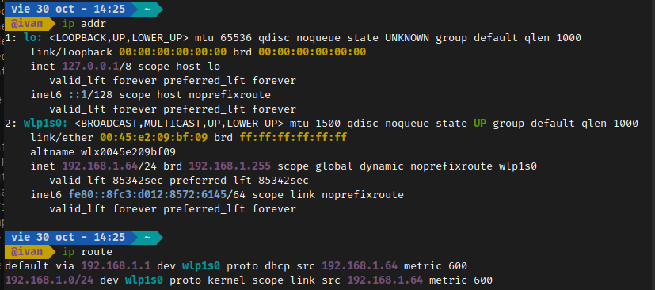
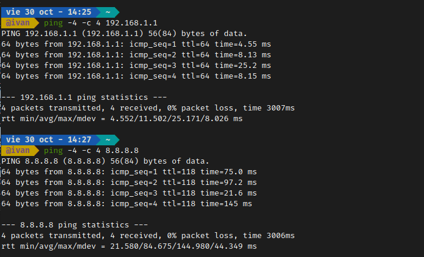
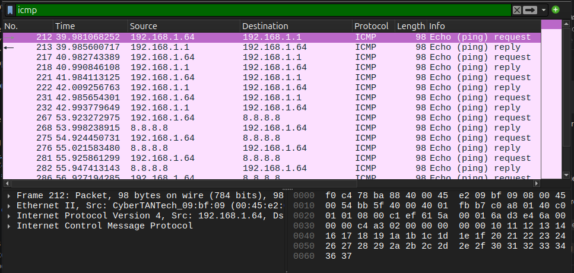
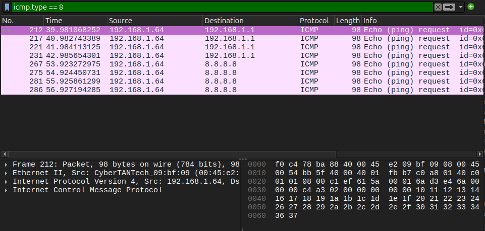
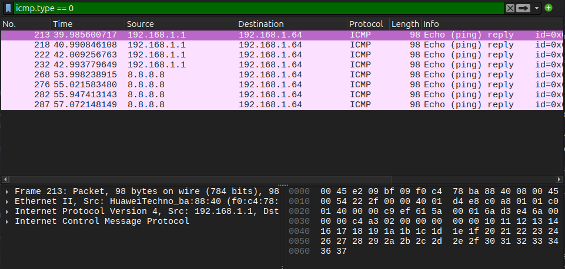
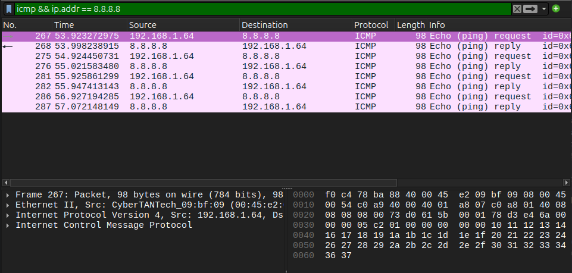
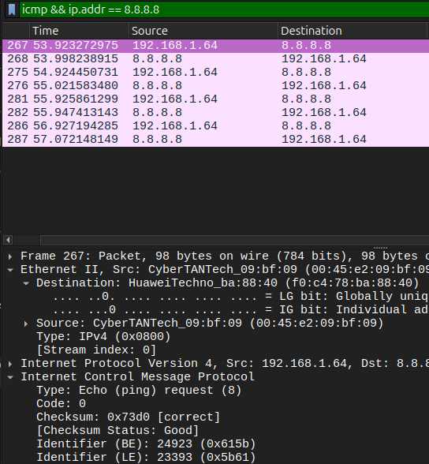
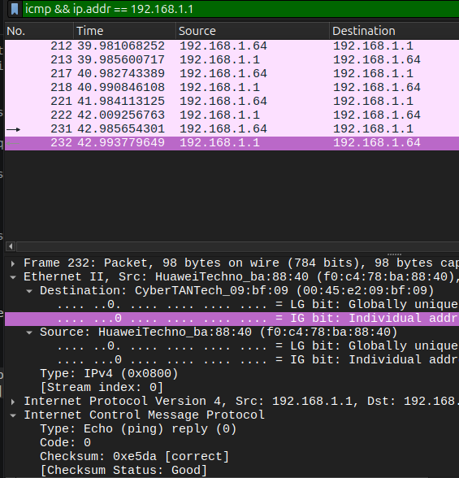

# Trabajo Práctico N.º 5: Transmisión de Datos: de ICMP y ARP a Sockets TCP entre Dos Computadoras

**Alumnos**
- García, Lautaro Misael 
- Pastrana Lizárraga, Iván
- Peretti, Federico Ariel
- Renaudo Gaggioli, Valentino
- Verdú, Melisa Noel

---

### Índice

- [Trabajo Práctico N.º 5: Transmisión de Datos: de ICMP y ARP a Sockets TCP entre Dos Computadoras](#trabajo-práctico-nº-5-transmisión-de-datos-de-icmp-y-arp-a-sockets-tcp-entre-dos-computadoras)
    - [Índice](#índice)
  - [ICMP y primer contacto con Wireshark.](#icmp-y-primer-contacto-con-wireshark)
    - [Fundamentos teóricos de ICMP y Ping](#fundamentos-teóricos-de-icmp-y-ping)
    - [Configuración de red y captura de tráfico](#configuración-de-red-y-captura-de-tráfico)
    - [Análisis de capas, encapsulación y campos](#análisis-de-capas-encapsulación-y-campos)
  - [ARP: de una IP a una dirección MAC](#arp-de-una-ip-a-una-dirección-mac)
    - [Resolución de direcciones y caché ARP](#resolución-de-direcciones-y-caché-arp)
    - [Generación y captura de tráfico ARP](#generación-y-captura-de-tráfico-arp)
    - [Análisis de tramas ARP Request y Reply](#análisis-de-tramas-arp-request-y-reply)
  - [TCP y UDP "a mano" con ncat](#tcp-y-udp-a-mano-con-ncat)
    - [Conceptos de la capa de transporte](#conceptos-de-la-capa-de-transporte)
    - [Experimento TCP en Loopback](#experimento-tcp-en-loopback)
    - [Experimento UDP en Loopback](#experimento-udp-en-loopback)
    - [Comparación detallada TCP vs. UDP](#comparación-detallada-tcp-vs-udp)
  - [Servidor TCP mínimo](#servidor-tcp-mínimo)
    - [Análisis de sockets TCP y correlación código-red](#análisis-de-sockets-tcp-y-correlación-código-red)
    - [Ejecución e inspección en Loopback](#ejecución-e-inspección-en-loopback)
  - [Conclusión](#conclusión)
  - [Referencias](#referencias)

---

## ICMP y primer contacto con Wireshark.

### Fundamentos teóricos de ICMP y Ping

<!-- 
Preguntas a responder:
a) ¿Qué es ICMP y para qué se usa? ¿Transporta datos de aplicaciones como lo hacen TCP o UDP?
b) ¿Qué relación tiene con IP? ¿Viaja dentro de IP, al lado de IP o debajo de IP? ¿Cómo sabe el receptor que el contenido de un paquete IP es ICMP?
c) ¿Qué hace ping? ¿Qué son un Echo Request y un Echo Reply? ¿Qué campos de ICMP permiten distinguirlos?
d) ¿Qué información mínima contiene un mensaje ICMP de tipo Echo?
-->

<!-- Respuesta a)-->

ICMP (Internet Control Message Protocol, RFC 792) es el protocolo de control y diagnostico de la pila TCP/IP. Lo usan los hosts y routers para avisar de errores y para hacer consultas sobre la red. Sus principales usos son:

- **Mensajes de error:** Destination Unreachable (red, host o puerto inalcanzable), Time Exceeded(el TTL llego a 0, que es lo que usa `traceroute`) y Redirect.
- **Mensajes de consulta:** Echo Request y Echo Reply, que son los que usa `ping`.

No transporta datos ni ofrece servicio de transporte, solo lleva informacion sobre la red.

<!-- Respuesta B -->

ICMP viaja dentro de IP: el mensaje ICMP va como payload de un datagrama IPv4. Aun asi se lo considera parte de la capa de red, porque su funcion es dar soporte a IP y no a las aplicaciones.

El receptor sabe que hay adentro por el campo **Protocol** del encabezado IPv4. **Protocol = 1** significa ICMP

<!-- Respuesta C -->

`Ping` comprueba si un host es alcanzable a nivel de IP. Envia un **Echo Request** y espera el **Echo Reply** que devuelve el destino, con eso mide el tiempo de ida y vuelta(RTT) y el porcentaje de paquetes perdidos.

- **Echo Request:** el emisor le pide al destino que le devuelva el mensaje.
- **Echo Reply:** el destino responde devolviendo el mismo identificador, numero de secuencia y datos.

Para distinguirlos se usan los siguientes campos:

- **Type:** 8 es Echo Request y 0 Echo Reply.**Code** vale 0 en ambos.
- **Identifier:** identifica el proceso `ping` que envio el mensaje, por si hay varios corriendo a la vez.
- **Sequence number:** permite emparejar cada Request con su Reply y detectar perdidas o desorden

<!-- Respuesta D -->
Tiene un encabezado de **8 bytes** seguido de los datos:

|Campo|Tamaño|
|-----|-------|
|Type(8 o 0)|1 byte|
|Code(0)|1byte|
|Checksum|2 bytes|
|Identifier|2 bytes|
|Sequence number|2 bytes|
|Data (payload,opcional)|variable|

### Configuración de red y captura de tráfico

<!-- 
Configuración de red local:
- IPv4, máscara, gateway por defecto y dirección MAC (ip addr / ip route / ipconfig).
- Capturas en Wireshark: ping al gateway y ping a 8.8.8.8.
- Filtros utilizados: icmp, icmp.type == 8, icmp.type == 0, icmp && ip.addr == 8.8.8.8.
-->

La configuración de red se obtuvo con `ip addr` e `ip route` en la computadora con Linux, conectada por Wi-Fi (interfaz `wlp1s0`):

|Parámetro|Valor|
|---------|-----|
|Dirección IPv4|192.168.1.64|
|Máscara|/24 (255.255.255.0)|
|Gateway por defecto|192.168.1.1|
|Dirección MAC|00:45:e2:09:bf:09|



Con Wireshark capturando en `wlp1s0`, se hizo ping al gateway y a 8.8.8.8 (4 paquetes cada uno). Todos los pings recibieron respuesta:



Luego se detuvo la captura y se aplicaron los filtros pedidos. Con `icmp` se ven los 16 paquetes: un Request y su Reply por cada ping, primero con el gateway (paquetes 212 a 232) y después con 8.8.8.8 (paquetes 267 a 287):



Con `icmp.type == 8` quedan solo los 8 Echo Request, todos con origen 192.168.1.64:



Con `icmp.type == 0` quedan solo los 8 Echo Reply, todos con destino 192.168.1.64:



Con `icmp && ip.addr == 8.8.8.8` queda el intercambio con 8.8.8.8 en ambos sentidos:



### Análisis de capas, encapsulación y campos

<!-- 
- Tabla de capas identificadas en Wireshark (Ethernet II, IPv4, ICMP, Payload) con direcciones origen/destino y campos selectores de protocolo superior.
- Análisis justificativo:
  a) MAC destino a 8.8.8.8 vs gateway (alcance MAC vs IP).
  b) Comparación Echo Request vs Echo Reply (campos que varían vs fijos, IDs y secuencia).
  c) Payload de ping (tamaño, contenido y diferencias entre SO).
  d) Análisis de TTL (Request vs Reply de 8.8.8.8 y acción del router).
  e) Diagrama de encapsulación "cajas dentro de cajas" con tamaños en bytes.
-->
|Capa|Origen|Destino|Campo que indica protoclo|
|----|------|-------|-------------------------|
|Ethernet II|00:45:e2:09:bf:09|f0:c4:78:ba:88:40|Type: IPv4 (0x0800)|
|Internet Protocol v4|192.168.1.64|8.8.8.8|Protocol: ICMP(1)|
|Internet Control Message Protocol|Identifier: 0x615b (24923)|Identifier: 0x615b (24923)|Type: 8 / Code: 0|
|Datos/payload|-|-|-|

<!-- Respuesta a) -->

#### a) MAC destino del Echo Request a 8.8.8.8

La MAC destino del Echo Request enviado a 8.8.8.8 (paquete 267) es `f0:c4:78:ba:88:40` (Wireshark la muestra como `HuaweiTechno_ba:88:40`), que **no es la MAC de 8.8.8.8** sino la del **router (gateway por defecto)** de nuestra red. En el intercambio con el gateway (192.168.1.1) aparece exactamente la misma MAC: es la MAC destino de los Request y la MAC origen de los Reply.





Esto ocurre porque 8.8.8.8 no pertenece a nuestra subred: el sistema operativo consulta la tabla de rutas, ve que el paquete debe salir por el gateway y arma la trama Ethernet dirigida a la MAC del router. La IP destino, en cambio, sigue siendo 8.8.8.8.

**Conclusión:** la dirección MAC tiene **alcance local** (un solo salto, dentro del mismo enlace) y se reescribe en cada router del camino. La dirección IP tiene **alcance extremo a extremo**: identifica al origen y al destino final y se mantiene durante todo el recorrido.

<!-- Respuesta b) -->

#### b) Comparación Echo Request vs. Echo Reply

Wireshark vincula cada Request con su Reply mediante el campo `[Response frame: …]`: por ejemplo, el Request 267 a 8.8.8.8 se responde en el paquete 268, y el Request 212 al gateway en el 213. Se compararon los bytes de los paquetes 212 y 213 en el panel hexadecimal (capturas de los filtros `icmp.type == 8` e `icmp.type == 0`):

|Capa|Campo|Request (212)|Reply (213)|
|----|-----|-------------|-----------|
|Ethernet II|MAC origen|00:45:e2:09:bf:09|f0:c4:78:ba:88:40|
|Ethernet II|MAC destino|f0:c4:78:ba:88:40|00:45:e2:09:bf:09|
|Ethernet II|Type|0x0800|0x0800|
|IPv4|Total length|84|84|
|IPv4|Identification|0xbb5f|0x222f|
|IPv4|Flags|0x40 (Don't fragment)|0x00|
|IPv4|TTL|64|64|
|IPv4|Protocol|1 (ICMP)|1 (ICMP)|
|IPv4|Header checksum|0xfbb7|0xd4e8|
|IPv4|IP origen|192.168.1.64|192.168.1.1|
|IPv4|IP destino|192.168.1.1|192.168.1.64|
|ICMP|Type|8 (Echo Request)|0 (Echo Reply)|
|ICMP|Code|0|0|
|ICMP|Checksum|0xc1ef|0xc9ef|
|ICMP|Identifier|0x615a|0x615a|
|ICMP|Sequence number|1|1|
|ICMP|Data|56 bytes|56 bytes (idénticos)|

En resumen:

|Capa|Campos que cambian|Campos que se mantienen|
|----|------------------|-----------------------|
|Ethernet II|MAC origen y MAC destino (se invierten)|Type: IPv4 (0x0800)|
|IPv4|IP origen y IP destino (se invierten), Identification, Flags, Header checksum y, con 8.8.8.8, también el TTL (64 → 118)|Version, Header length, Total length, Protocol: ICMP (1)|
|ICMP|Type (8 → 0), Checksum|Code (0), Identifier, Sequence number, Data|

Justificación de cada cambio:

- **Direcciones MAC e IP:** la respuesta viaja en sentido contrario, por lo que origen y destino se intercambian.
- **TTL:** lo fija el sistema que genera cada paquete (cada SO usa su propio valor inicial) y lo decrementa cada router del camino. Con el gateway coincide (ambos usan 64 y no hay routers en el medio), pero con 8.8.8.8 no (ver punto d).
- **Identification y Flags (IP):** los asigna de forma independiente cada host al crear su datagrama. Linux marca sus Request con *Don't fragment* y el router no lo hace en su respuesta.
- **Type ICMP:** pasa de 8 (Echo Request) a 0 (Echo Reply) porque el mensaje ahora es una respuesta.
- **Checksums (IP e ICMP):** se recalculan porque cambió el contenido que protegen. En ICMP la diferencia es exactamente 0x0800 (0xc1ef → 0xc9ef), porque lo único que cambió en el mensaje es el Type, de 8 a 0.

El **Identifier** y el **Sequence number** se mantienen porque el destino debe copiarlos tal cual en la respuesta: así `ping` puede emparejar cada Reply con el Request que lo originó, calcular el RTT de cada uno y detectar paquetes perdidos o desordenados. El Identifier distingue qué proceso `ping` envió el mensaje y el Sequence number distingue cada envío dentro de ese proceso.

<!-- Respuesta c) -->

#### c) Payload de ping

El payload está al final del mensaje ICMP, en el campo **Data**. Tiene **56 bytes**, que es el tamaño por defecto del `ping` de Linux. Su contenido es:

- Los primeros **16 bytes** son una marca de tiempo (*timestamp*, segundos y microsegundos) del momento en que se envió el Request. `ping` la usa para calcular el RTT cuando vuelve la respuesta. En el paquete 212 son `6a d3 e4 6a 00 00 00 00 c4 a3 02 00 00 00 00 00`.
- Los **40 bytes** restantes son un patrón de relleno con valores consecutivos (`0x10, 0x11, 0x12, … 0x37`), que en el panel hexadecimal se ve desde el offset 0x0032 hasta el final de la trama.

En el Echo Reply (paquete 213) el payload es **idéntico**, byte por byte, ya que el destino lo devuelve sin modificarlo. Se puede comprobar comparando el panel hexadecimal de las capturas de los filtros `icmp.type == 8` e `icmp.type == 0`.

En Windows, en cambio, el payload por defecto es de **32 bytes** con el texto `abcdefghijklmnopqrstuvwabcdefghi`. Que sean distintos sugiere que el contenido no lo define el protocolo ICMP sino **la implementación de `ping` de cada sistema operativo**. Por eso, observando el payload (junto con el TTL inicial), se puede inferir qué SO generó el tráfico.

<!-- Respuesta d) -->

#### d) TTL

El Echo Request que enviamos tiene **TTL = 64**, el valor inicial que usa Linux. El Echo Reply que llegó de 8.8.8.8 tiene **TTL = 118**, como se ve en la salida de `ping` (`ttl=118`). En cambio, el Reply del gateway llegó con `ttl=64`.

No son iguales por dos motivos:

1. Cada sistema operativo o equipo elige su propio TTL inicial (valores típicos: 64, 128 o 255).
2. **Cada router que reenvía el paquete decrementa el TTL en 1.** Si llega a 0, el router lo descarta y envía al origen un ICMP *Time Exceeded*. Esto evita que un paquete circule indefinidamente si hay un bucle de enrutamiento.

El TTL que recibimos es entonces el valor inicial del servidor menos la cantidad de routers atravesados. Como 118 es mayor que 64, el servidor de Google debe haber usado un valor inicial de 128: la respuesta atravesó aproximadamente **128 − 118 = 10 routers** hasta llegar a nuestra red. El Reply del gateway, en cambio, llega con TTL 64 sin decrementar, porque el router es el que lo genera y está a un solo salto de nuestra computadora.

<!-- Respuesta e) -->

#### e) Encapsulación del Echo Request

```text
┌──────────────── Trama Ethernet II: 98 bytes ────────────────┐
│ Encabezado Ethernet (14 B)                                  │
│ ┌──────────── Datagrama IPv4: 84 bytes ───────────────────┐ │
│ │ Encabezado IP (20 B)                                    │ │
│ │ ┌──────────── Mensaje ICMP: 64 bytes ─────────────────┐ │ │
│ │ │ Encabezado ICMP (8 B)                               │ │ │
│ │ │ ┌───────── Datos: 56 bytes ───────────────────────┐ │ │ │
│ │ │ │ timestamp (16 B) + patrón de relleno (40 B)     │ │ │ │
│ │ │ └─────────────────────────────────────────────────┘ │ │ │
│ │ └─────────────────────────────────────────────────────┘ │ │
│ └─────────────────────────────────────────────────────────┘ │
└─────────────────────────────────────────────────────────────┘
```

|Caja|Encabezado|Contenido|Total|
|----|----------|---------|-----|
|Trama Ethernet II|14 bytes|84 bytes (datagrama IP)|98 bytes|
|Datagrama IPv4|20 bytes|64 bytes (mensaje ICMP)|84 bytes|
|Mensaje ICMP|8 bytes|56 bytes (datos)|64 bytes|
|Datos (payload)|—|56 bytes|56 bytes|

---

## ARP: de una IP a una dirección MAC

### Resolución de direcciones y caché ARP

<!-- 
Preguntas conceptuales:
a) ¿Qué problema resuelve ARP? ¿En qué capa se ubica y por qué es discutible?
b) ¿Qué es un ARP Request y un ARP Reply? ¿A quién se envía cada uno?
c) ¿Qué es la caché ARP y por qué existe?
d) Explicación con palabras propias del mecanismo de resolución en LAN.
e) Inspección de la caché ARP local (arp -a / ip neigh show) y verificación de la MAC del gateway.
-->

### Generación y captura de tráfico ARP

<!-- 
- Procedimiento para generar tráfico ARP nuevo (Opción A: IP inexistente en LAN, Opción B: borrado de caché del gateway, Opción C: ping a otro host LAN).
- Captura de tráfico con filtros: arp, arp.opcode, arp.dst.proto_ipv4, arp || icmp, eth.dst == ff:ff:ff:ff:ff:ff.
-->

### Análisis de tramas ARP Request y Reply

<!-- 
- Tabla comparativa de campos de ARP Request y Reply (MAC destino/origen Ethernet, Opcode, Sender MAC/IP, Target MAC/IP).
- Preguntas de análisis:
  a) Por qué Request es broadcast y Reply unicast; valor de Target MAC en Request.
  b) Campo EtherType en Ethernet (0x0806) y ausencia de encabezado IP (dónde vive ARP).
  c) Observación con IP inexistente (reintentos de ARP, presencia/ausencia de ICMP).
  d) Reintento de ping tras 1 minuto (comportamiento de caché, ventajas y riesgos de entradas desactualizadas).
-->

---

## TCP y UDP "a mano" con ncat

### Conceptos de la capa de transporte

<!-- 
Investigación previa:
a) ¿Qué significa "establecer una conexión"? ¿Dónde "existe" una conexión TCP (cables, routers o extremos)?
b) ¿Qué es un puerto? ¿Qué identifica el par (IP, puerto)?
c) ¿Qué significa que un proceso esté "escuchando" en un puerto?
-->

### Experimento TCP en Loopback

<!-- 
- Ejecución con ncat en loopback (puerto 12000): servidor ncat -v -l 12000, cliente ncat -v 127.0.0.1 12000.
- Captura Wireshark con filtro tcp.port == 12000 en interfaz loopback (lo / Npcap Loopback).
- Intercambio de mensajes y cierre de sesión.
-->

### Experimento UDP en Loopback

<!-- 
- Ejecución con ncat en loopback (puerto 12001): servidor ncat -v -u -l 12001, cliente ncat -v -u 127.0.0.1 12001.
- Captura Wireshark con filtro udp.port == 12001 en interfaz loopback.
- Intercambio de datagramas y cierre con Ctrl+C.
-->

### Comparación detallada TCP vs. UDP

<!-- 
Respuestas a las consignas de análisis:
a) Comportamiento en la red al ejecutar el cliente antes del primer mensaje (TCP vs UDP).
b) Datagramas generados por mensaje y presencia/ausencia de ACKs.
c) Comparación de encabezados (campos y tamaños en bytes de TCP vs UDP).
d) Comportamiento al cerrar con Ctrl+C (teardown de TCP vs silencio de UDP).
e) Cantidad total de paquetes para una misma frase (overhead vs confiabilidad).
f) Comportamiento ante puertos cerrados (RST en TCP vs ICMP Port Unreachable en UDP).
-->

---

## Servidor TCP mínimo

### Análisis de sockets TCP y correlación código-red

<!-- 
- Tabla de primitivas de Sockets (socket, bind, listen, connect, accept, sendall, recv, close):
  * Dónde se ejecuta (cliente / servidor / ambos).
  * ¿Genera tráfico de red o es operación local del SO?
  * Segmentos y flags observados en Wireshark (SYN, SYN-ACK, ACK, PSH-ACK, FIN-ACK).
- Relación entre código en Python y eventos en la red (creación de socket dedicado en accept, detección de FIN con recv retornando b"").
-->

### Ejecución e inspección en Loopback

<!-- 
- Ejecución de tcp_server.py y tcp_client.py en loopback (127.0.0.1:12000).
- Captura de Wireshark con filtro tcp.port == 12000.
- Registro de salidas de consola y trazabilidad con los paquetes capturados.
-->

---

## Conclusión

<!-- 
Sección a completar al finalizar todas las partes de la práctica.
-->

---

## Referencias

<!-- 
Bibliografía y fuentes consultadas.
-->
