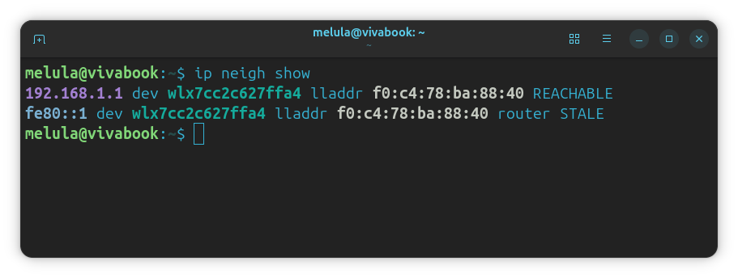

# Trabajo Práctico N.º 5: Transmisión de Datos: de ICMP y ARP a Sockets TCP entre Dos Computadoras

**Alumnos**
- García, Lautaro Misael 
- Pastrana Lizárraga, Iván
- Peretti, Federico Ariel
- Renaudo Gaggioli, Valentino
- Verdú, Melisa Noel

---

### Índice

- [Trabajo Práctico N.º 5: Transmisión de Datos: de ICMP y ARP a Sockets TCP entre Dos Computadoras](#trabajo-práctico-nº-5-transmisión-de-datos-de-icmp-y-arp-a-sockets-tcp-entre-dos-computadoras)
    - [Índice](#índice)
  - [ICMP y primer contacto con Wireshark.](#icmp-y-primer-contacto-con-wireshark)
    - [Fundamentos teóricos de ICMP y Ping](#fundamentos-teóricos-de-icmp-y-ping)
    - [Configuración de red y captura de tráfico](#configuración-de-red-y-captura-de-tráfico)
    - [Análisis de capas, encapsulación y campos](#análisis-de-capas-encapsulación-y-campos)
  - [ARP: de una IP a una dirección MAC](#arp-de-una-ip-a-una-dirección-mac)
    - [Resolución de direcciones y caché ARP](#resolución-de-direcciones-y-caché-arp)
    - [Generación y captura de tráfico ARP](#generación-y-captura-de-tráfico-arp)
    - [Análisis de tramas ARP Request y Reply](#análisis-de-tramas-arp-request-y-reply)
  - [TCP y UDP "a mano" con ncat](#tcp-y-udp-a-mano-con-ncat)
    - [Conceptos de la capa de transporte](#conceptos-de-la-capa-de-transporte)
    - [Experimento TCP en Loopback](#experimento-tcp-en-loopback)
    - [Experimento UDP en Loopback](#experimento-udp-en-loopback)
    - [Comparación detallada TCP vs. UDP](#comparación-detallada-tcp-vs-udp)
  - [Servidor TCP mínimo](#servidor-tcp-mínimo)
    - [Análisis de sockets TCP y correlación código-red](#análisis-de-sockets-tcp-y-correlación-código-red)
    - [Ejecución e inspección en Loopback](#ejecución-e-inspección-en-loopback)
  - [Conclusión](#conclusión)
  - [Referencias](#referencias)

---

## ICMP y primer contacto con Wireshark.

### Fundamentos teóricos de ICMP y Ping

<!-- 
Preguntas a responder:
a) ¿Qué es ICMP y para qué se usa? ¿Transporta datos de aplicaciones como lo hacen TCP o UDP?
b) ¿Qué relación tiene con IP? ¿Viaja dentro de IP, al lado de IP o debajo de IP? ¿Cómo sabe el receptor que el contenido de un paquete IP es ICMP?
c) ¿Qué hace ping? ¿Qué son un Echo Request y un Echo Reply? ¿Qué campos de ICMP permiten distinguirlos?
d) ¿Qué información mínima contiene un mensaje ICMP de tipo Echo?
-->

### Configuración de red y captura de tráfico

<!-- 
Configuración de red local:
- IPv4, máscara, gateway por defecto y dirección MAC (ip addr / ip route / ipconfig).
- Capturas en Wireshark: ping al gateway y ping a 8.8.8.8.
- Filtros utilizados: icmp, icmp.type == 8, icmp.type == 0, icmp && ip.addr == 8.8.8.8.
-->

### Análisis de capas, encapsulación y campos

<!-- 
- Tabla de capas identificadas en Wireshark (Ethernet II, IPv4, ICMP, Payload) con direcciones origen/destino y campos selectores de protocolo superior.
- Análisis justificativo:
  a) MAC destino a 8.8.8.8 vs gateway (alcance MAC vs IP).
  b) Comparación Echo Request vs Echo Reply (campos que varían vs fijos, IDs y secuencia).
  c) Payload de ping (tamaño, contenido y diferencias entre SO).
  d) Análisis de TTL (Request vs Reply de 8.8.8.8 y acción del router).
  e) Diagrama de encapsulación "cajas dentro de cajas" con tamaños en bytes.
-->

---

## ARP: de una IP a una dirección MAC

### Resolución de direcciones y caché ARP

<!-- 
Preguntas conceptuales:
a) ¿Qué problema resuelve ARP? ¿En qué capa se ubica y por qué es discutible?
b) ¿Qué es un ARP Request y un ARP Reply? ¿A quién se envía cada uno?
c) ¿Qué es la caché ARP y por qué existe?
d) Explicación con palabras propias del mecanismo de resolución en LAN.
e) Inspección de la caché ARP local (arp -a / ip neigh show) y verificación de la MAC del gateway.
-->

<!-- Respuesta a) -->

Las direcciones IP sirven para identificar a un host de extremo a extremo, pero dentro de una red local las tramas Ethernet (o Wi-Fi) se entregan usando direcciones **MAC**. Cuando un host quiere enviar un datagrama IP a otro equipo de su misma red, conoce su IP pero necesita su MAC para armar la trama. **ARP** (Address Resolution Protocol, RFC 826) resuelve ese problema: traduce una dirección IPv4 a la dirección MAC correspondiente dentro del mismo enlace.

Su ubicación en el modelo de capas es discutible porque tiene características de las dos capas entre las que trabaja:

- **Parece de capa 2 (enlace):** sus mensajes viajan directamente dentro de una trama Ethernet (EtherType `0x0806`), sin encabezado IP, y nunca salen de la red local: los routers no los reenvían.
- **Parece de capa 3 (red):** maneja direcciones IP y existe solo para darle servicio a IP.

Por eso muchas veces se lo ubica "entre" ambas capas, como un protocolo de capa 2,5.

<!-- Respuesta b) -->

- **ARP Request (Opcode 1):** es la pregunta *"¿Quién tiene la IP X? Respondele a la IP Y"*. Como el emisor todavía no sabe la MAC del destino, la envía en **broadcast** (MAC destino `ff:ff:ff:ff:ff:ff`), de modo que la reciben todos los equipos de la red local. Incluye la MAC e IP del emisor y la IP buscada; el campo de MAC buscada va en ceros.
- **ARP Reply (Opcode 2):** es la respuesta *"La IP X está en la MAC Z"*. La envía únicamente el equipo que tiene la IP buscada, y la manda en **unicast** directamente al que preguntó, ya que conoce su MAC gracias al Request.

<!-- Respuesta c) -->

La **caché ARP** es una tabla temporal que mantiene el sistema operativo con las asociaciones IP → MAC ya resueltas. Existe para no tener que hacer un Request antes de cada paquete: si cada envío requiriera un broadcast, se agregaría demora a la comunicación y se cargaría a todos los equipos de la red, que deben procesar cada broadcast.

Las entradas no son permanentes: vencen después de un tiempo o se vuelven a confirmar, porque una IP puede pasar a otro equipo (por ejemplo, al reasignarse por DHCP). En Linux, `ip neigh show` muestra el estado de cada entrada; los más comunes son `REACHABLE` (confirmada recientemente), `STALE` (vieja, se reconfirma la próxima vez que se use), `INCOMPLETE` (se envió un Request y se espera la respuesta) y `FAILED` (nadie respondió).

<!-- Respuesta d) -->

Cuando un host quiere enviar un paquete IP, el proceso es el siguiente:

1. Usando su máscara, decide si el destino está en su misma red. Si está, la MAC que necesita es la del destino; si no, es la del **gateway**, que va a reenviar el paquete. Por eso en el punto anterior la trama dirigida a 8.8.8.8 llevaba como MAC destino la del router.
2. Busca esa IP en su caché ARP. Si la encuentra, arma la trama con esa MAC y la envía.
3. Si no la encuentra, deja el paquete en espera y envía un ARP Request en broadcast preguntando por esa IP.
4. Todos los equipos de la red reciben el Request, pero solo el que tiene esa IP responde, con un ARP Reply unicast que contiene su MAC.
5. El host guarda la asociación en su caché y recién ahí envía el paquete que tenía en espera. El que respondió también aprovecha el Request para guardar la MAC del que preguntó.

<!-- Respuesta e) -->

Las pruebas de esta sección se hicieron en una computadora con Linux conectada por Wi-Fi a la misma red que la del punto anterior:

|Parámetro|Valor|
|---------|-----|
|Interfaz|`wlx7cc2c627ffa4` (Wi-Fi USB TP-Link)|
|Dirección IPv4|192.168.1.95/24|
|Dirección MAC|7c:c2:c6:27:ff:a4|
|Gateway por defecto|192.168.1.1|

Con `ip neigh show` se inspeccionó la caché ARP:

La entrada `192.168.1.1 ... lladdr f0:c4:78:ba:88:40 REACHABLE` indica que el gateway tiene la MAC **`f0:c4:78:ba:88:40`** y que la asociación fue confirmada recientemente. Es la misma MAC que apareció como destino de las tramas hacia 8.8.8.8 en el punto anterior, lo que confirma que es la del router. La segunda línea (`fe80::1`) es la entrada IPv6 del mismo router; IPv6 no usa ARP sino NDP (Neighbor Discovery), por lo que no se analiza aquí.

### Generación y captura de tráfico ARP

<!-- 
- Procedimiento para generar tráfico ARP nuevo (Opción A: IP inexistente en LAN, Opción B: borrado de caché del gateway, Opción C: ping a otro host LAN).
- Captura de tráfico con filtros: arp, arp.opcode, arp.dst.proto_ipv4, arp || icmp, eth.dst == ff:ff:ff:ff:ff:ff.
-->

### Análisis de tramas ARP Request y Reply

<!-- 
- Tabla comparativa de campos de ARP Request y Reply (MAC destino/origen Ethernet, Opcode, Sender MAC/IP, Target MAC/IP).
- Preguntas de análisis:
  a) Por qué Request es broadcast y Reply unicast; valor de Target MAC en Request.
  b) Campo EtherType en Ethernet (0x0806) y ausencia de encabezado IP (dónde vive ARP).
  c) Observación con IP inexistente (reintentos de ARP, presencia/ausencia de ICMP).
  d) Reintento de ping tras 1 minuto (comportamiento de caché, ventajas y riesgos de entradas desactualizadas).
-->

---

## TCP y UDP "a mano" con ncat

### Conceptos de la capa de transporte

<!-- 
Investigación previa:
a) ¿Qué significa "establecer una conexión"? ¿Dónde "existe" una conexión TCP (cables, routers o extremos)?
b) ¿Qué es un puerto? ¿Qué identifica el par (IP, puerto)?
c) ¿Qué significa que un proceso esté "escuchando" en un puerto?
-->

### Experimento TCP en Loopback

<!-- 
- Ejecución con ncat en loopback (puerto 12000): servidor ncat -v -l 12000, cliente ncat -v 127.0.0.1 12000.
- Captura Wireshark con filtro tcp.port == 12000 en interfaz loopback (lo / Npcap Loopback).
- Intercambio de mensajes y cierre de sesión.
-->

### Experimento UDP en Loopback

<!-- 
- Ejecución con ncat en loopback (puerto 12001): servidor ncat -v -u -l 12001, cliente ncat -v -u 127.0.0.1 12001.
- Captura Wireshark con filtro udp.port == 12001 en interfaz loopback.
- Intercambio de datagramas y cierre con Ctrl+C.
-->

### Comparación detallada TCP vs. UDP

<!-- 
Respuestas a las consignas de análisis:
a) Comportamiento en la red al ejecutar el cliente antes del primer mensaje (TCP vs UDP).
b) Datagramas generados por mensaje y presencia/ausencia de ACKs.
c) Comparación de encabezados (campos y tamaños en bytes de TCP vs UDP).
d) Comportamiento al cerrar con Ctrl+C (teardown de TCP vs silencio de UDP).
e) Cantidad total de paquetes para una misma frase (overhead vs confiabilidad).
f) Comportamiento ante puertos cerrados (RST en TCP vs ICMP Port Unreachable en UDP).
-->

---

## Servidor TCP mínimo

### Análisis de sockets TCP y correlación código-red

<!-- 
- Tabla de primitivas de Sockets (socket, bind, listen, connect, accept, sendall, recv, close):
  * Dónde se ejecuta (cliente / servidor / ambos).
  * ¿Genera tráfico de red o es operación local del SO?
  * Segmentos y flags observados en Wireshark (SYN, SYN-ACK, ACK, PSH-ACK, FIN-ACK).
- Relación entre código en Python y eventos en la red (creación de socket dedicado en accept, detección de FIN con recv retornando b"").
-->

### Ejecución e inspección en Loopback

<!-- 
- Ejecución de tcp_server.py y tcp_client.py en loopback (127.0.0.1:12000).
- Captura de Wireshark con filtro tcp.port == 12000.
- Registro de salidas de consola y trazabilidad con los paquetes capturados.
-->

---

## Conclusión

<!-- 
Sección a completar al finalizar todas las partes de la práctica.
-->

---

## Referencias

<!-- 
Bibliografía y fuentes consultadas.
-->
