# Trabajo Práctico N.º 5: Transmisión de Datos: de ICMP y ARP a Sockets TCP entre Dos Computadoras

**Alumnos**
- García, Lautaro Misael 
- Pastrana Lizárraga, Iván
- Peretti, Federico Ariel
- Renaudo Gaggioli, Valentino
- Verdú, Melisa Noel

---

### Índice

1. [ICMP y primer contacto con Wireshark](#icmp-y-primer-contacto-con-wireshark)
2. [ARP: de una IP a una dirección MAC](#arp-de-una-ip-a-una-dirección-mac)
3. [TCP y UDP "a mano" con ncat](#tcp-y-udp-a-mano-con-ncat)
4. [Servidor TCP mínimo](#servidor-tcp-mínimo)
5. [Conclusión](#conclusión)
6. [Referencias](#referencias)

---

## ICMP y primer contacto con Wireshark

### Fundamentos teóricos de ICMP y Ping

#### a) ¿Qué es ICMP y para qué se usa?

ICMP (Internet Control Message Protocol, RFC 792 [4]) es el protocolo de control y diagnóstico de la pila TCP/IP [1], [2], [3]. Lo usan los hosts y routers para avisar de errores y para hacer consultas sobre la red. Sus principales usos son:

- **Mensajes de error:** Destination Unreachable (red, host o puerto inalcanzable), Time Exceeded (el TTL llegó a 0, que es lo que usa `traceroute`) y Redirect.
- **Mensajes de consulta:** Echo Request y Echo Reply, que son los que usa `ping`.

No transporta datos de aplicaciones ni ofrece servicio de transporte: no tiene puertos y solo lleva información sobre la red.

#### b) Relación entre ICMP e IP

ICMP viaja dentro de IP: el mensaje ICMP va como payload de un datagrama IPv4. Aun así se lo considera parte de la capa de red, porque su función es dar soporte a IP y no a las aplicaciones.

El receptor sabe qué hay adentro por el campo **Protocol** del encabezado IPv4. **Protocol = 1** significa ICMP [5].

#### c) Ping, Echo Request y Echo Reply

`ping` comprueba si un host es alcanzable a nivel de IP. Envía un **Echo Request** y espera el **Echo Reply** que devuelve el destino; con eso mide el tiempo de ida y vuelta (RTT) y el porcentaje de paquetes perdidos [7].

- **Echo Request:** el emisor le pide al destino que le devuelva el mensaje.
- **Echo Reply:** el destino responde devolviendo el mismo identificador, número de secuencia y datos.

Para distinguirlos se usan los siguientes campos:

- **Type:** 8 es Echo Request y 0 es Echo Reply. **Code** vale 0 en ambos.
- **Identifier:** identifica el proceso `ping` que envió el mensaje, por si hay varios corriendo a la vez.
- **Sequence number:** permite emparejar cada Request con su Reply y detectar pérdidas o desorden.

#### d) Información mínima de un mensaje ICMP Echo

Tiene un encabezado de **8 bytes** seguido de los datos [2], [4]:

| Campo | Tamaño |
| :--- | :--- |
| Type (8 o 0) | 1 byte |
| Code (0) | 1 byte |
| Checksum | 2 bytes |
| Identifier | 2 bytes |
| Sequence number | 2 bytes |
| Data (payload, opcional) | variable |

---

### Configuración de red y captura de tráfico

La configuración de red se obtuvo con `ip addr` e `ip route` en la computadora con Linux, conectada por Wi-Fi (interfaz `wlp1s0`):

| Parámetro | Valor |
| :--- | :--- |
| Dirección IPv4 | 192.168.1.64 |
| Máscara | /24 (255.255.255.0) |
| Gateway por defecto | 192.168.1.1 |
| Dirección MAC | 00:45:e2:09:bf:09 |

<p align="center">
  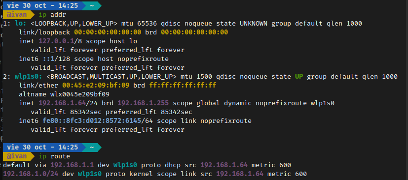
</p>

Con Wireshark capturando en `wlp1s0`, se hizo ping al gateway y a 8.8.8.8 (4 paquetes cada uno). Todos los pings recibieron respuesta:

<p align="center">
  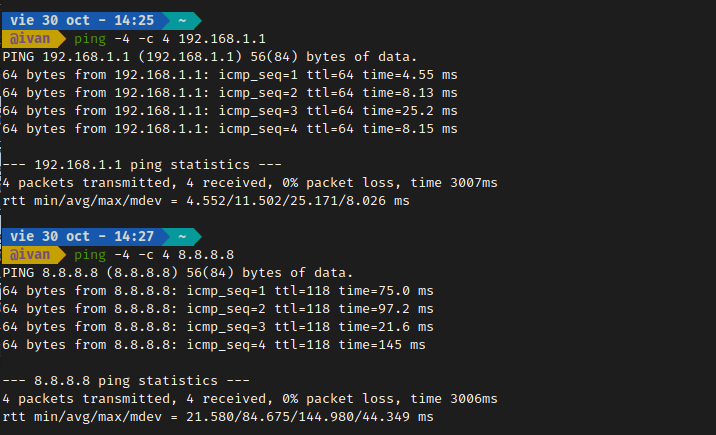
</p>

Luego se detuvo la captura y se aplicaron los filtros pedidos [6]. Con `icmp` quedan 16 paquetes: un Request y su Reply por cada ping, primero con el gateway (paquetes 212 a 232) y después con 8.8.8.8 (paquetes 267 a 287). La captura de pantalla muestra los primeros 15; el último Reply (287) aparece en las capturas de los filtros siguientes:

<p align="center">
  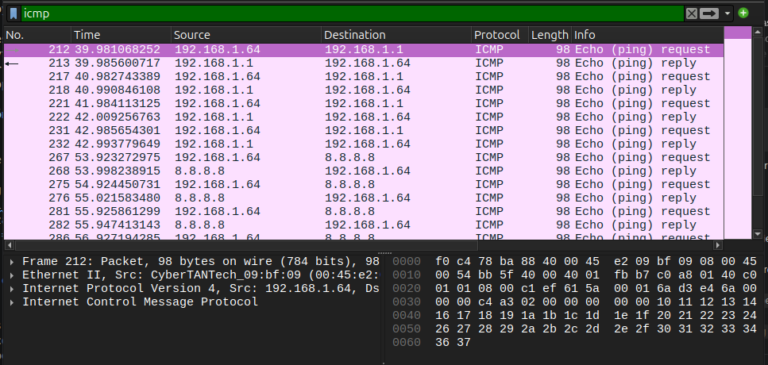
</p>

Con `icmp.type == 8` quedan solo los 8 Echo Request, todos con origen 192.168.1.64:

<p align="center">
  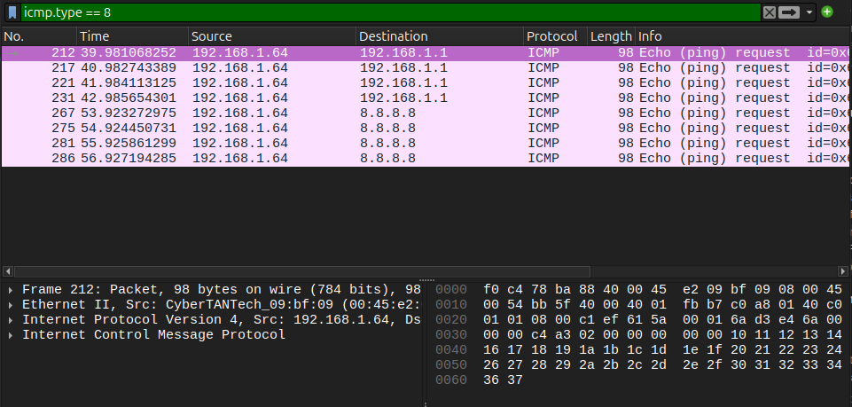
</p>

Con `icmp.type == 0` quedan solo los 8 Echo Reply, todos con destino 192.168.1.64:

<p align="center">
  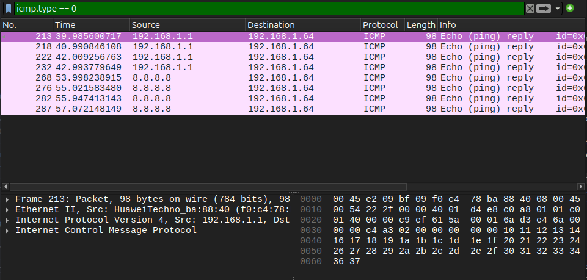
</p>

Con `icmp && ip.addr == 8.8.8.8` queda el intercambio con 8.8.8.8 en ambos sentidos:

<p align="center">
  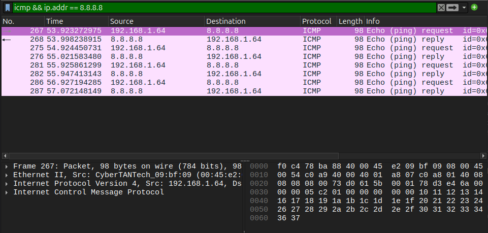
</p>

---

### Análisis de capas, encapsulación y campos

La siguiente tabla corresponde al Echo Request **267**, enviado a 8.8.8.8:

| Capa | Origen | Destino | Campo que indica protocolo |
| :--- | :--- | :--- | :--- |
| Ethernet II | 00:45:e2:09:bf:09 | f0:c4:78:ba:88:40 | Type: IPv4 (0x0800) |
| Internet Protocol Version 4 | 192.168.1.64 | 8.8.8.8 | Protocol: ICMP (1) |
| Internet Control Message Protocol | — | — | — (los datos van directo como payload) |
| Datos / payload | — | — | — |

ICMP no tiene direcciones propias: el mensaje se identifica con Type 8 / Code 0 y con el Identifier `0x615b` (24923), pero esos campos no indican ningún protocolo superior.

Aunque la captura se hizo sobre Wi-Fi (`wlp1s0`), Wireshark muestra la capa de enlace como **Ethernet II** y no como 802.11. Esto se debe a que, fuera del modo monitor, el driver de la placa inalámbrica convierte las tramas 802.11 al formato Ethernet II antes de entregárselas al sistema operativo, así que Wireshark recibe tramas con encabezado Ethernet de 14 bytes.

#### a) MAC destino del Echo Request a 8.8.8.8

La MAC destino del Echo Request enviado a 8.8.8.8 (paquete 267) es `f0:c4:78:ba:88:40` (Wireshark la muestra como `HuaweiTechno_ba:88:40`), que **no es la MAC de 8.8.8.8** sino la del **router (gateway por defecto)** de nuestra red. En el intercambio con el gateway (192.168.1.1) aparece exactamente la misma MAC: es la MAC destino de los Request y la MAC origen de los Reply.

<p align="center">
  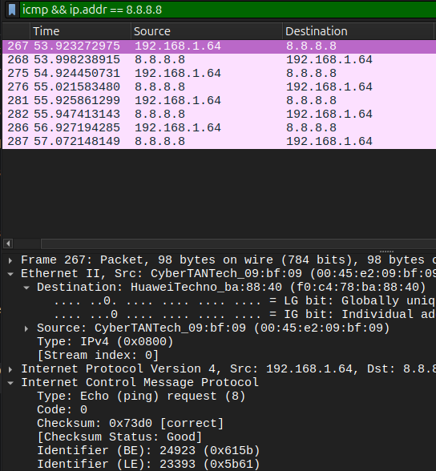
</p>

<p align="center">
  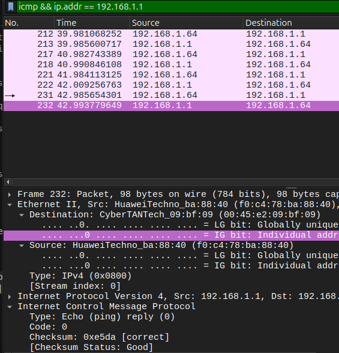
</p>

Esto ocurre porque 8.8.8.8 no pertenece a nuestra subred: el sistema operativo consulta la tabla de rutas, ve que el paquete debe salir por el gateway y arma la trama Ethernet dirigida a la MAC del router. La IP destino, en cambio, sigue siendo 8.8.8.8.

**Conclusión:** la dirección MAC tiene **alcance local** (un solo salto, dentro del mismo enlace) y se reescribe en cada router del camino. La dirección IP tiene **alcance extremo a extremo**: identifica al origen y al destino final y se mantiene durante todo el recorrido.

#### b) Comparación Echo Request vs. Echo Reply

Wireshark vincula cada Request con su Reply mediante el campo `[Response frame: …]`: por ejemplo, el Request 267 a 8.8.8.8 se responde en el paquete 268, y el Request 212 al gateway en el 213. Se compararon los bytes de los paquetes 212 y 213 en el panel hexadecimal (capturas de los filtros `icmp.type == 8` e `icmp.type == 0`):

| Capa | Campo | Request (212) | Reply (213) |
| :--- | :--- | :--- | :--- |
| Ethernet II | MAC origen | 00:45:e2:09:bf:09 | f0:c4:78:ba:88:40 |
| Ethernet II | MAC destino | f0:c4:78:ba:88:40 | 00:45:e2:09:bf:09 |
| Ethernet II | Type | 0x0800 | 0x0800 |
| IPv4 | Total length | 84 | 84 |
| IPv4 | Identification | 0xbb5f | 0x222f |
| IPv4 | Flags | 0x40 (Don't fragment) | 0x00 |
| IPv4 | TTL | 64 | 64 |
| IPv4 | Protocol | 1 (ICMP) | 1 (ICMP) |
| IPv4 | Header checksum | 0xfbb7 | 0xd4e8 |
| IPv4 | IP origen | 192.168.1.64 | 192.168.1.1 |
| IPv4 | IP destino | 192.168.1.1 | 192.168.1.64 |
| ICMP | Type | 8 (Echo Request) | 0 (Echo Reply) |
| ICMP | Code | 0 | 0 |
| ICMP | Checksum | 0xc1ef | 0xc9ef |
| ICMP | Identifier | 0x615a | 0x615a |
| ICMP | Sequence number | 1 | 1 |
| ICMP | Data | 56 bytes | 56 bytes (idénticos) |

En resumen:

| Capa | Campos que cambian | Campos que se mantienen |
| :--- | :--- | :--- |
| Ethernet II | MAC origen y MAC destino (se invierten) | Type: IPv4 (0x0800) |
| IPv4 | IP origen y IP destino (se invierten), Identification, Flags, Header checksum y, con 8.8.8.8, también el TTL (64 → 118) | Version, Header length, Total length, Protocol: ICMP (1) |
| ICMP | Type (8 → 0), Checksum | Code (0), Identifier, Sequence number, Data |

Justificación de cada cambio:

- **Direcciones MAC e IP:** la respuesta viaja en sentido contrario, por lo que origen y destino se intercambian.
- **TTL:** lo fija el sistema que genera cada paquete (cada SO usa su propio valor inicial) y lo decrementa cada router del camino. Con el gateway coincide (ambos usan 64 y no hay routers en el medio), pero con 8.8.8.8 no (ver punto d).
- **Identification y Flags (IP):** los asigna de forma independiente cada host al crear su datagrama. Linux marca sus Request con *Don't fragment* y el router no lo hace en su respuesta.
- **Type ICMP:** pasa de 8 (Echo Request) a 0 (Echo Reply) porque el mensaje ahora es una respuesta.
- **Checksums (IP e ICMP):** se recalculan porque cambió el contenido que protegen. En ICMP la diferencia es exactamente 0x0800 (0xc1ef → 0xc9ef), porque lo único que cambió en el mensaje es el Type, de 8 a 0.

El **Identifier** y el **Sequence number** se mantienen porque el destino debe copiarlos tal cual en la respuesta: así `ping` puede emparejar cada Reply con el Request que lo originó, calcular el RTT de cada uno y detectar paquetes perdidos o desordenados. El Identifier distingue qué proceso `ping` envió el mensaje y el Sequence number distingue cada envío dentro de ese proceso.

#### c) Payload de ping

El payload está al final del mensaje ICMP, en el campo **Data**. Tiene **56 bytes**, que es el tamaño por defecto del `ping` de Linux. Su contenido es:

- Los primeros **16 bytes** son una marca de tiempo (*timestamp*, segundos y microsegundos) del momento en que se envió el Request. `ping` la usa para calcular el RTT cuando vuelve la respuesta. En el paquete 212 son `6a d3 e4 6a 00 00 00 00 c4 a3 02 00 00 00 00 00`.
- Los **40 bytes** restantes son un patrón de relleno con valores consecutivos (`0x10, 0x11, 0x12, … 0x37`), que en el panel hexadecimal se ve desde el offset 0x003a (14 + 20 + 8 + 16 = 58 bytes) hasta el final de la trama: en la fila `0030`, el `10` es el byte número 11.

En el Echo Reply (paquete 213) el payload es **idéntico**, byte por byte, ya que el destino lo devuelve sin modificarlo. Se puede comprobar comparando el panel hexadecimal de las capturas de los filtros `icmp.type == 8` e `icmp.type == 0`.

En Windows, en cambio, el payload por defecto es de **32 bytes** con el texto `abcdefghijklmnopqrstuvwabcdefghi`. Que sean distintos sugiere que el contenido no lo define el protocolo ICMP sino **la implementación de `ping` de cada sistema operativo**. Por eso, observando el payload (junto con el TTL inicial), se puede inferir qué SO generó el tráfico.

#### d) TTL

El Echo Request que enviamos tiene **TTL = 64**, el valor inicial que usa Linux. El Echo Reply que llegó de 8.8.8.8 tiene **TTL = 118**, como se ve en la salida de `ping` (`ttl=118`). En cambio, el Reply del gateway llegó con `ttl=64`.

No son iguales por dos motivos:

1. Cada sistema operativo o equipo elige su propio TTL inicial (valores típicos: 64, 128 o 255).
2. **Cada router que reenvía el paquete decrementa el TTL en 1.** Si llega a 0, el router lo descarta y envía al origen un ICMP *Time Exceeded*. Esto evita que un paquete circule indefinidamente si hay un bucle de enrutamiento.

El TTL que recibimos es entonces el valor inicial del servidor menos la cantidad de routers atravesados. Como 118 es mayor que 64, el servidor de Google debe haber usado un valor inicial de 128: la respuesta atravesó aproximadamente **128 − 118 = 10 routers** hasta llegar a nuestra red. El Reply del gateway, en cambio, llega con TTL 64 sin decrementar, porque el router es el que lo genera y está a un solo salto de nuestra computadora.

#### e) Encapsulación del Echo Request

```text
┌──────────────── Trama Ethernet II: 98 bytes ────────────────┐
│ Encabezado Ethernet (14 B)                                  │
│ ┌──────────── Datagrama IPv4: 84 bytes ───────────────────┐ │
│ │ Encabezado IP (20 B)                                    │ │
│ │ ┌──────────── Mensaje ICMP: 64 bytes ─────────────────┐ │ │
│ │ │ Encabezado ICMP (8 B)                               │ │ │
│ │ │ ┌───────── Datos: 56 bytes ───────────────────────┐ │ │ │
│ │ │ │ timestamp (16 B) + patrón de relleno (40 B)     │ │ │ │
│ │ │ └─────────────────────────────────────────────────┘ │ │ │
│ │ └─────────────────────────────────────────────────────┘ │ │
│ └─────────────────────────────────────────────────────────┘ │
└─────────────────────────────────────────────────────────────┘
```

| Caja | Encabezado | Contenido | Total |
| :--- | :--- | :--- | :--- |
| Trama Ethernet II | 14 bytes | 84 bytes (datagrama IP) | 98 bytes |
| Datagrama IPv4 | 20 bytes | 64 bytes (mensaje ICMP) | 84 bytes |
| Mensaje ICMP | 8 bytes | 56 bytes (datos) | 64 bytes |
| Datos (payload) | — | 56 bytes | 56 bytes |

Los 98 bytes son los que informa Wireshark (`98 bytes on wire`) y no incluyen el preámbulo (8 bytes) ni el FCS (4 bytes) de la trama, porque la placa de red los procesa y los descarta antes de entregarle la trama al sistema operativo, así que Wireshark no los captura.

---

## ARP: de una IP a una dirección MAC

### Resolución de direcciones y caché ARP

#### a) Problema que resuelve ARP y ubicación en el modelo de capas

Las direcciones IP sirven para identificar a un host de extremo a extremo, pero dentro de una red local las tramas Ethernet (o Wi-Fi) se entregan usando direcciones **MAC**. Cuando un host quiere enviar un datagrama IP a otro equipo de su misma red, conoce su IP pero necesita su MAC para armar la trama. **ARP** (Address Resolution Protocol, RFC 826) resuelve ese problema: traduce una dirección IPv4 a la dirección MAC correspondiente dentro del mismo enlace.

Su ubicación en el modelo de capas es discutible porque tiene características de las dos capas entre las que trabaja:

- **Parece de capa 2 (enlace):** sus mensajes viajan directamente dentro de una trama Ethernet (EtherType `0x0806`), sin encabezado IP, y nunca salen de la red local: los routers no los reenvían.
- **Parece de capa 3 (red):** maneja direcciones IP y existe solo para darle servicio a IP.

Por eso muchas veces se lo ubica "entre" ambas capas, como un protocolo de capa 2,5 [1].

#### b) ARP Request y ARP Reply

- **ARP Request (Opcode 1):** es la pregunta *"¿Quién tiene la IP X? Respondele a la IP Y"*. Como el emisor todavía no sabe la MAC del destino, la envía en **broadcast** (MAC destino `ff:ff:ff:ff:ff:ff`), de modo que la reciben todos los equipos de la red local. Incluye la MAC e IP del emisor y la IP buscada; el campo de MAC buscada va en ceros.
- **ARP Reply (Opcode 2):** es la respuesta *"La IP X está en la MAC Z"*. La envía únicamente el equipo que tiene la IP buscada, y la manda en **unicast** directamente al que preguntó, ya que conoce su MAC gracias al Request [1], [3].

#### c) Caché ARP

La **caché ARP** es una tabla temporal que mantiene el sistema operativo con las asociaciones IP → MAC ya resueltas. Existe para no tener que hacer un Request antes de cada paquete: si cada envío requiriera un broadcast, se agregaría demora a la comunicación y se cargaría a todos los equipos de la red, que deben procesar cada broadcast [2].

Las entradas no son permanentes: vencen después de un tiempo o se vuelven a confirmar, porque una IP puede pasar a otro equipo (por ejemplo, al reasignarse por DHCP). En Linux, `ip neigh show` muestra el estado de cada entrada; los más comunes son `REACHABLE` (confirmada recientemente), `STALE` (vieja, se reconfirma la próxima vez que se use), `INCOMPLETE` (se envió un Request y se espera la respuesta) y `FAILED` (nadie respondió).

#### d) Mecanismo de resolución en la LAN

Cuando un host quiere enviar un paquete IP, el proceso es el siguiente:

1. Usando su máscara, decide si el destino está en su misma red. Si está, la MAC que necesita es la del destino; si no, es la del **gateway**, que va a reenviar el paquete. Por eso en el punto anterior la trama dirigida a 8.8.8.8 llevaba como MAC destino la del router.
2. Busca esa IP en su caché ARP. Si la encuentra, arma la trama con esa MAC y la envía.
3. Si no la encuentra, deja el paquete en espera y envía un ARP Request en broadcast preguntando por esa IP.
4. Todos los equipos de la red reciben el Request, pero solo el que tiene esa IP responde, con un ARP Reply unicast que contiene su MAC.
5. El host guarda la asociación en su caché y recién ahí envía el paquete que tenía en espera. El que respondió también aprovecha el Request para guardar la MAC del que preguntó [1].

#### e) Inspección de la caché ARP

Las pruebas de esta sección se hicieron en una computadora con Linux conectada por Wi-Fi a la misma red que la del punto anterior:

| Parámetro | Valor |
| :--- | :--- |
| Interfaz | `wlx7cc2c627ffa4` (Wi-Fi USB TP-Link) |
| Dirección IPv4 | 192.168.1.95/24 |
| Dirección MAC | 7c:c2:c6:27:ff:a4 |
| Gateway por defecto | 192.168.1.1 |

Con `ip neigh show` se inspeccionó la caché ARP:

<p align="center">
  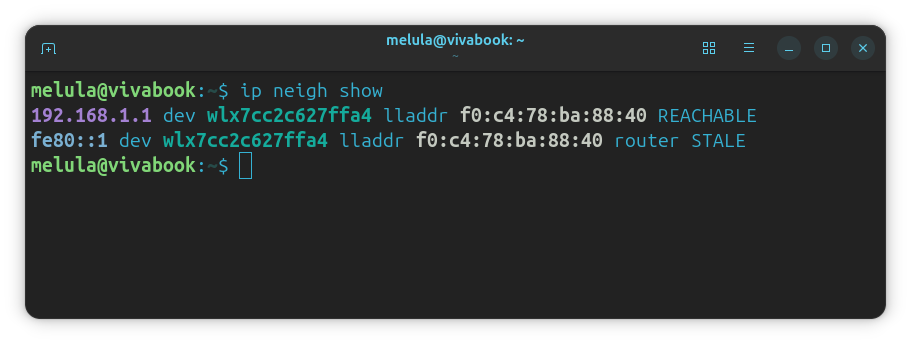
</p>

La entrada `192.168.1.1 ... lladdr f0:c4:78:ba:88:40 REACHABLE` indica que el gateway tiene la MAC **`f0:c4:78:ba:88:40`** y que la asociación fue confirmada recientemente. Es la misma MAC que apareció como destino de las tramas hacia 8.8.8.8 en el punto anterior, lo que confirma que es la del router. La segunda línea (`fe80::1`) es la entrada IPv6 del mismo router; IPv6 no usa ARP sino NDP (Neighbor Discovery), por lo que no se analiza aquí.

---

### Generación y captura de tráfico ARP

Todas las pruebas se hicieron en una única captura de Wireshark sobre la interfaz Wi-Fi `wlx7cc2c627ffa4`. No se usó la interfaz de loopback porque ARP solo se usa cuando hay que entregar tramas en un enlace físico: el tráfico hacia 127.0.0.1 nunca necesita una dirección MAC. Para generar tráfico ARP nuevo se usaron las opciones A y B de la consigna.

#### Opción B: borrado de la entrada del gateway

Con Wireshark capturando, se borró de la caché la entrada del gateway y se le hizo ping, todo en una sola línea:

```bash
sudo ip neigh del 192.168.1.1 dev wlx7cc2c627ffa4; ip neigh show; ping -4 -c 4 192.168.1.1; ip neigh show
```

Los comandos se encadenaron con `;` porque, en un primer intento hecho de a uno, la computadora volvió a resolver la MAC del gateway por su propio tráfico (navegación, actualizaciones) en los segundos que pasaron entre el borrado y el `ip neigh show`. Ejecutados juntos, se ve el ciclo completo:

<p align="center">
  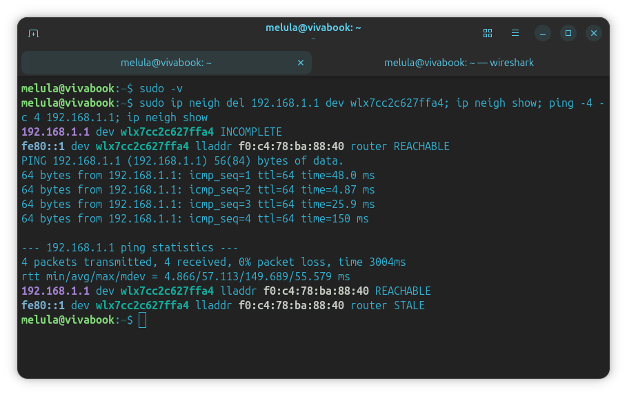
</p>

1. Después del borrado, el gateway aparece como `INCOMPLETE`: la entrada existe pero sin MAC, porque ya se envió un ARP Request y se está esperando la respuesta.
2. El ping funciona normalmente (4 de 4 respuestas).
3. Al final, el gateway vuelve a figurar como `REACHABLE`, con la misma MAC `f0:c4:78:ba:88:40`.

Con el filtro `arp` se observan los mensajes ARP de toda la captura. En Wireshark, `TPLink_27:ff:a4` corresponde a nuestra computadora y `HuaweiTechno_ba:88:40` al router: Wireshark reemplaza los primeros 3 bytes de la MAC por el nombre del fabricante.

<p align="center">
  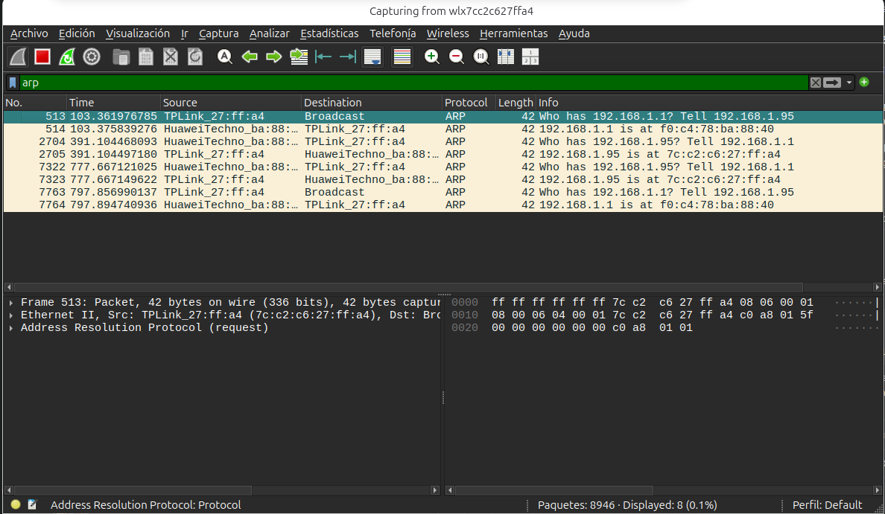
</p>

| Paquetes | Quién pregunta | MAC destino del Request | Descripción |
| :--- | :--- | :--- | :--- |
| 513 / 514 | Nuestra computadora, por 192.168.1.1 | Broadcast | Resolución del primer intento, disparada por el tráfico propio |
| 2704 / 2705 | El router, por 192.168.1.95 | Nuestra MAC (unicast) | El router reconfirma su propia entrada ARP |
| 7322 / 7323 | El router, por 192.168.1.95 | Nuestra MAC (unicast) | Ídem |
| 7763 / 7764 | Nuestra computadora, por 192.168.1.1 | Broadcast | Resolución correspondiente a la terminal anterior |

El par **7763 / 7764** es el que se analiza en detalle en la sección siguiente. Para aislar cada uno se usaron los filtros `arp.opcode == 1` (solo Requests) y `arp.opcode == 2` (solo Replies).

#### Opción A: ping a una IP inexistente

Se hizo ping a 192.168.1.253, una dirección de la subred que no está asignada a ningún equipo, y luego se inspeccionó la caché:

```bash
ping -4 -c 4 192.168.1.253
ip neigh show
```

<p align="center">
  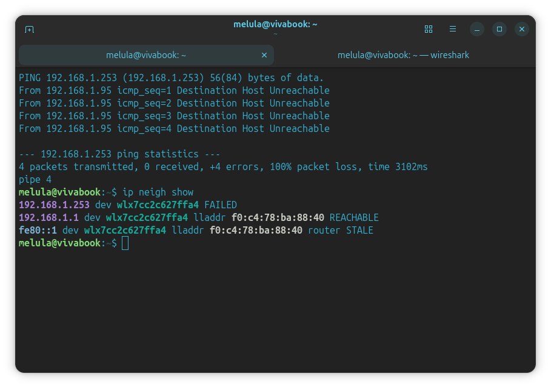
</p>

Los cuatro pings fallan con `Destination Host Unreachable`, informado por **nuestra propia computadora** (`From 192.168.1.95`) y no por el router. La caché registra la dirección como `192.168.1.253 ... FAILED`, sin MAC.

Con el filtro `arp.dst.proto_ipv4 == 192.168.1.253`, que selecciona los mensajes ARP cuyo *Target IP address* es esa dirección, quedan solamente los Requests hacia la IP inexistente:

<p align="center">
  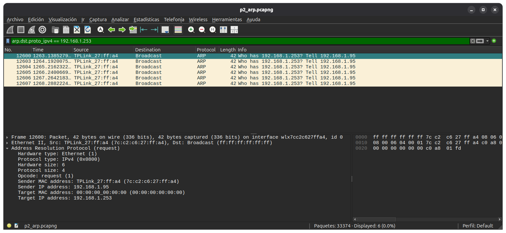
</p>

Con el filtro `arp || icmp` se ven juntos el tráfico ARP y los pings, para comprobar si algún Echo Request llegó a salir hacia esa dirección:

<p align="center">
  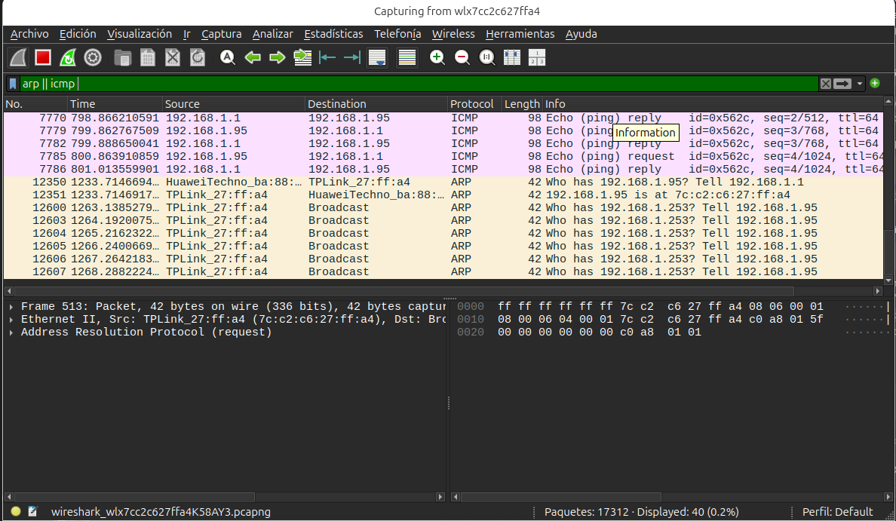
</p>

#### Tráfico broadcast

Por último, con el filtro `eth.dst == ff:ff:ff:ff:ff:ff` se muestran todas las tramas Ethernet enviadas a broadcast, de cualquier protocolo:

<p align="center">
  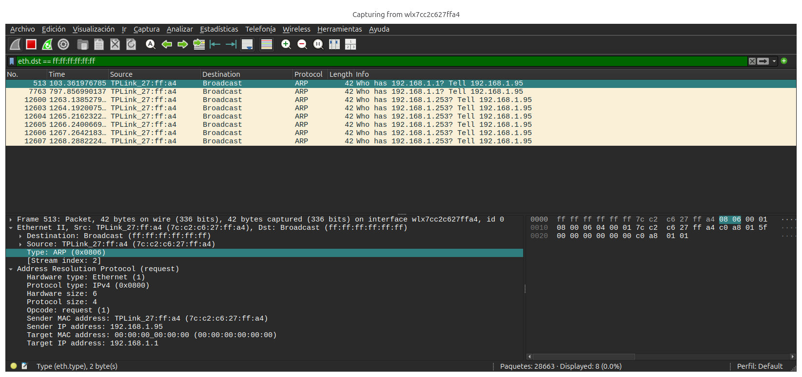
</p>

Las 8 tramas que aparecen son ARP Requests enviados por nuestra computadora: 2 hacia el gateway (513 y 7763) y 6 hacia 192.168.1.253. Ninguno de los Requests del router aparece en este filtro, porque todos fueron enviados en unicast.

---

### Análisis de tramas ARP Request y Reply

Se analizaron el ARP Request 7763 y su ARP Reply 7764, correspondientes a la Opción B. Para cada uno se desplegaron en Wireshark los encabezados Ethernet II y ARP:

<p align="center">
  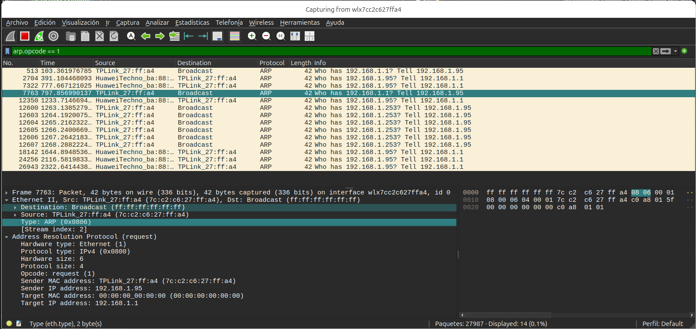
</p>

<p align="center">
  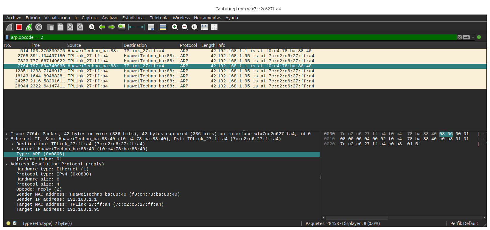
</p>

| Campo | ARP Request (7763) | ARP Reply (7764) |
| :--- | :--- | :--- |
| MAC destino (Ethernet) | ff:ff:ff:ff:ff:ff (Broadcast) | 7c:c2:c6:27:ff:a4 |
| MAC origen (Ethernet) | 7c:c2:c6:27:ff:a4 | f0:c4:78:ba:88:40 |
| Opcode | 1 (request) | 2 (reply) |
| Sender MAC | 7c:c2:c6:27:ff:a4 | f0:c4:78:ba:88:40 |
| Sender IP | 192.168.1.95 | 192.168.1.1 |
| Target MAC | 00:00:00:00:00:00 | 7c:c2:c6:27:ff:a4 |
| Target IP | 192.168.1.1 | 192.168.1.95 |

En el Reply, los campos Sender y Target se invierten respecto del Request, y el Target MAC pasa de estar en ceros a contener nuestra MAC.

#### a) Request broadcast y Reply unicast

El Request se envía en broadcast porque lo que se busca es justamente la MAC del destino: sin conocerla, no hay otra forma de hacerle llegar la pregunta que enviarla a todos los equipos de la red. Por eso el **Target MAC del Request vale `00:00:00:00:00:00`**: es la incógnita, y el campo se completa con ceros porque no tiene un valor útil.

El Reply, en cambio, se envía en unicast porque quien responde ya sabe a quién contestarle: el Request trae la MAC del que pregunta en el campo *Sender MAC*. Enviarlo a broadcast molestaría innecesariamente a los demás equipos de la red.

En la captura también se observa que el broadcast solo es necesario cuando la MAC es desconocida. Los Requests del router (paquetes 2704, 7322, 12350, 18142, 24256 y 26943) preguntan por 192.168.1.95, pero van dirigidos directamente a nuestra MAC: el router ya la tiene en su caché y solo está verificando que siga siendo válida [2]. Por eso ninguno de ellos aparece con el filtro `eth.dst == ff:ff:ff:ff:ff:ff`.

#### b) EtherType y ausencia de encabezado IP

En el encabezado Ethernet II de ambas tramas, el campo **Type vale `0x0806`**, que identifica a ARP. Es el mismo campo que en el punto anterior valía `0x0800` para IPv4: le indica al receptor qué protocolo viene a continuación. En el panel hexadecimal de las capturas aparece resaltado como los bytes `08 06`.

Inmediatamente después del encabezado Ethernet viene el mensaje ARP, **sin ningún encabezado IP en el medio**. Esto muestra que ARP no viaja dentro de IP, sino directamente sobre la capa de enlace. Una consecuencia de esto es que los mensajes ARP no tienen IP de origen ni de destino en un encabezado, ni TTL, y por lo tanto no pueden ser enrutados: nunca salen de la red local.

Cada trama ocupa 42 bytes: 14 del encabezado Ethernet y 28 del mensaje ARP.

| Campo ARP | Tamaño | Valor en el Request |
| :--- | :--- | :--- |
| Hardware type | 2 bytes | 1 (Ethernet) |
| Protocol type | 2 bytes | 0x0800 (IPv4) |
| Hardware size | 1 byte | 6 |
| Protocol size | 1 byte | 4 |
| Opcode | 2 bytes | 1 (request) |
| Sender MAC | 6 bytes | 7c:c2:c6:27:ff:a4 |
| Sender IP | 4 bytes | 192.168.1.95 |
| Target MAC | 6 bytes | 00:00:00:00:00:00 |
| Target IP | 4 bytes | 192.168.1.1 |

Los campos *Hardware type* y *Protocol type* indican qué tipo de direcciones se están traduciendo (Ethernet e IPv4), y *Hardware size* y *Protocol size* su longitud (6 bytes una MAC, 4 bytes una IPv4) [2].

#### c) IP inexistente

En las capturas de la Opción A se observa que:

- **Se enviaron 6 ARP Requests** preguntando por 192.168.1.253 (paquetes 12600 y 12603 a 12607), todos a broadcast y separados por aproximadamente un segundo. La computadora reintenta porque un Request o su respuesta podrían haberse perdido.
- **No hubo ningún ARP Reply**, ya que ningún equipo tiene esa dirección.
- **No salió ningún paquete ICMP** hacia 192.168.1.253. Con el filtro `arp || icmp`, los únicos Echo Request y Echo Reply de la captura son los del ping al gateway.

Esto ocurre porque, sin la MAC del destino, no es posible armar la trama Ethernet que llevaría el Echo Request. Los pings quedaron en espera mientras se intentaba la resolución (`pipe 4` en la salida de `ping`) y, al no recibir respuesta, el sistema operativo marcó la entrada como `FAILED` y descartó los paquetes. Por eso el mensaje `Destination Host Unreachable` lo informa nuestra propia computadora (`From 192.168.1.95`) y no aparece en la captura: se genera localmente y nunca viaja por la red.

#### d) Ping repetido después de 1 minuto

Pasado más de un minuto desde la resolución de la Opción B, se repitió el ping al gateway:

<p align="center">
  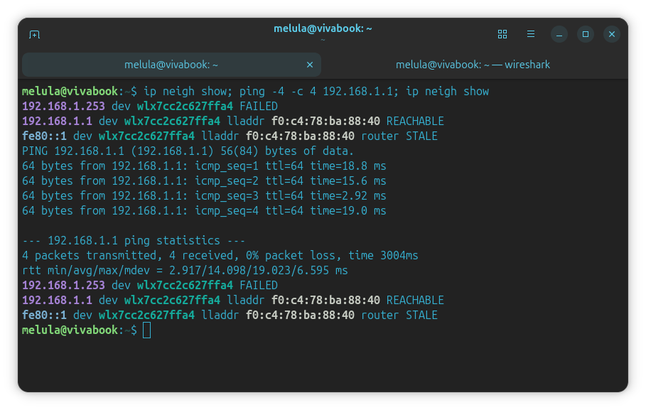
</p>

<p align="center">
  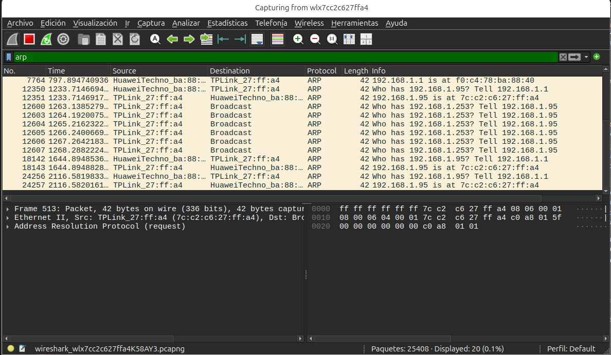
</p>

Antes del ping, el gateway ya figuraba como `REACHABLE` con su MAC, y en la captura **no aparece ningún ARP Request nuevo de nuestra computadora** después del 7763: la MAC se tomó directamente de la caché. Los únicos mensajes ARP nuevos (24256 / 24257) son otra verificación unicast iniciada por el router. La entrada seguía siendo válida aunque pasaron varios minutos desde su resolución porque la computadora usa el gateway constantemente para salir a Internet, y ese tráfico permite confirmar que la asociación sigue siendo correcta sin necesidad de volver a preguntar.

**Ventajas de la caché:**

- Se evita la demora de resolver la MAC antes de cada paquete.
- Se reduce el tráfico broadcast, que todos los equipos de la red deben recibir y procesar.

**Riesgos de las entradas desactualizadas:**

- Si una IP pasa a otro equipo (por ejemplo, al reemplazar el router o al reasignarse una dirección por DHCP), los hosts siguen enviando las tramas a la MAC vieja hasta que la entrada vence o se reconfirma, y esos paquetes se pierden.
- ARP no tiene autenticación: un host acepta un Reply sin poder verificar quién lo envió. Un atacante puede enviar Replies falsos asociando la IP del gateway a su propia MAC (*ARP spoofing*). La víctima guarda esa asociación en su caché y empieza a enviarle todo su tráfico al atacante, que puede leerlo o modificarlo (ataque de intermediario o *man-in-the-middle*).

---

## TCP y UDP "a mano" con ncat

### Conceptos de la capa de transporte

#### a) ¿Qué significa "establecer una conexión"? ¿Dónde "existe" una conexión TCP (cables, routers o extremos)?

Establecer una conexión implica que dos extremos ejecutan un procedimiento previo de señalización y sincronización antes de transferir datos. En TCP, esto se realiza mediante el acuerdo en tres fases (*three-way handshake*: SYN, SYN-ACK, ACK), donde cliente y servidor sincronizan sus números de secuencia iniciales (ISN), acuerdan opciones como el MSS y asignan buffers y variables de control en el sistema operativo [1], [3].

La conexión TCP es puramente **lógica** y reside exclusivamente en los **extremos terminales** (en las entidades TCP de los hosts). La infraestructura intermedia (routers y switches) no mantiene ningún estado de la conexión ni es consciente de ella; opera en capas inferiores conmutando y reenviando datagramas IP independientes.

#### b) ¿Qué es un puerto? ¿Qué identifica el par (IP, puerto)?

Un **puerto** es un identificador numérico de 16 bits (0 a 65535) en la capa de transporte (denominado TSAP según Tanenbaum [3]) cuyo fin es la **multiplexación y demultiplexación**: permite que múltiples procesos en un mismo host compartan la interfaz de red, entregando cada segmento entrante al socket correspondiente.

El par **(IP, puerto)** identifica de manera unívoca un **socket** o punto final (*endpoint*) de comunicación en la red: la IP direcciona al host y el puerto al proceso o servicio local. Una conexión TCP establecida queda luego unívocamente individualizada por la 4-tupla $(\text{IP}_{\text{orig}}, \text{Puerto}_{\text{orig}}, \text{IP}_{\text{dest}}, \text{Puerto}_{\text{dest}})$.

#### c) ¿Qué significa que un proceso esté "escuchando" en un puerto?

Significa que un proceso ha instanciado un socket, lo ha vinculado a un puerto mediante `bind()` y lo ha puesto en modo pasivo mediante la primitiva `listen()`. En este estado, el proceso no emite datos activamente; la pila TCP del sistema operativo queda a la espera de solicitudes entrantes de conexión (SYN) dirigidas a ese puerto y las encola hasta que la aplicación las procese con `accept()` [3].

---

### Experimento TCP en Loopback

Para analizar el comportamiento de TCP en la interfaz de bucle invertido (*loopback* `lo`), se ejecutó una sesión cliente-servidor utilizando `ncat` en el puerto `12000`, monitoreando el tráfico con Wireshark mediante el filtro `tcp.port == 12000`.

1. **Servidor pasivo (en escucha):**
   ```bash
   ncat -v -l 12000
   ```
2. **Cliente activo:**
   ```bash
   ncat -v 127.0.0.1 12000
   ```

Una vez establecida la conexión, se transmitieron mensajes de texto bidireccionales y finalmente se terminó la sesión enviando una señal de interrupción (`Ctrl + C`) desde el cliente.

<p align="center">
  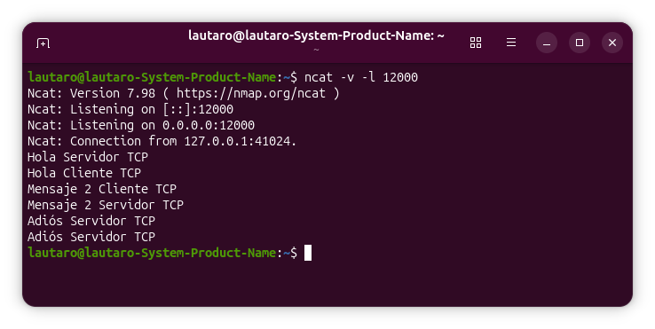
</p>

<p align="center">
  
</p>

A nivel de red, la captura en Wireshark evidencia las tres etapas fundamentales del ciclo de vida de una conexión TCP orientada a la conexión:

<p align="center">
  
</p>

1. **Establecimiento de conexión (*three-way handshake*):**
   - **Segmento 1 (`SYN`):** El cliente (`127.0.0.1:41024`) envía un flag `SYN` con un número de secuencia inicial aleatorio (`Seq=0` relativo, ISN = `3013143511`), solicitando sincronización y negociando opciones como MSS (`65495`), SACK permitido, Timestamps y escala de ventana (`WS=1024`).
   - **Segmento 2 (`SYN, ACK`):** El servidor (`127.0.0.1:12000`) responde con sus flags `SYN` y `ACK`, asignando su propio ISN (`Seq=0` relativo, ISN = `480945039`) y confirmando la recepción del cliente (`Ack=1` relativo, `3013143512`).
   - **Segmento 3 (`ACK`):** El cliente confirma la recepción (`Seq=1 Ack=1`, raw: `Seq=3013143512`, `Ack=480945040`), quedando la conexión formalmente en estado `ESTABLISHED`.
2. **Transferencia de datos confiable:**
   - Cada línea de texto enviada viaja en un segmento con flags `[PSH, ACK]`, indicando a la capa de transporte receptora que entregue los datos de inmediato a la aplicación sin esperar a llenar el buffer.
   - Cada segmento de datos es seguido inmediatamente por un segmento de confirmación pura `[ACK]` sin payload (`Len=0`) generado por el receptor, validando la entrega confiable y actualizando el control de flujo.
3. **Finalización de la conexión (*teardown*):**
   - Al pulsar `Ctrl + C` en el cliente, la aplicación cierra su socket y el sistema operativo emite un segmento `[FIN, ACK]`.
   - El servidor responde confirmando la recepción y cerrando su extremo con `[FIN, ACK]`, y el cliente emite el último `[ACK]`, concluyendo el cierre ordenado de la sesión.

---

### Experimento UDP en Loopback

En contraposición, se evaluó el protocolo de datagramas de usuario (UDP) bajo el mismo esquema en el puerto `12001`, aplicando en Wireshark el filtro `udp.port == 12001`.

1. **Receptor UDP:**
   ```bash
   ncat -v -u -l 12001
   ```
2. **Emisor UDP:**
   ```bash
   ncat -v -u 127.0.0.1 12001
   ```

Se enviaron las mismas 6 frases interactivas en ambos sentidos y se interrumpió la ejecución mediante `Ctrl + C`.

<p align="center">
  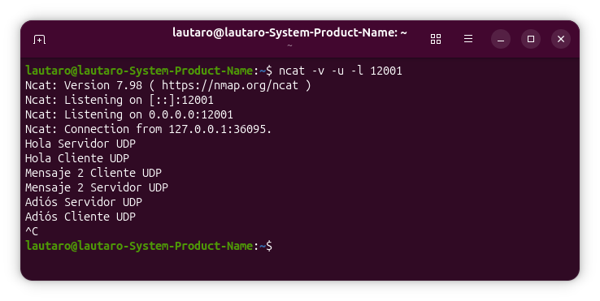
</p>

<p align="center">
  
</p>

La captura de tráfico evidencia las características de un servicio no orientado a la conexión y no confiable:

<p align="center">
  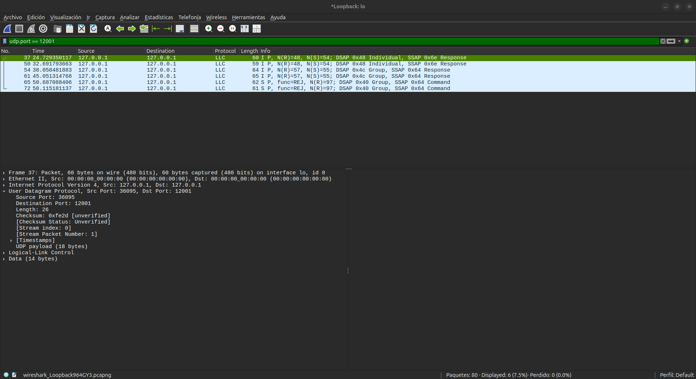
</p>

- **Ausencia de señalización previa:** El cliente no emite ningún paquete de saludo ni sincronización al iniciar el proceso; el primer paquete en circular por la red es el que ya contiene el primer mensaje de aplicación (`"Hola Servidor UDP\n"`).
- **Transmisión de datagramas independientes:** Cada mensaje viaja encapsulado en un único datagrama UDP aislado. No existe ningún segmento de asentimiento (`ACK`) de retorno por parte del receptor. *(Nota: en la columna Protocol de Wireshark se visualiza `LLC` debido a que el disector heurístico intenta interpretar el payload sobre el puerto 12001, observándose en el árbol inferior el encabezado `User Datagram Protocol` completo).*
- **Terminación sin aviso:** Al presionar `Ctrl + C`, el proceso simplemente finaliza en el espacio de usuario. En la red no se genera ningún paquete de notificación ni cierre; la comunicación concluye en silencio absoluto.

---

### Comparación detallada TCP vs. UDP

A partir de los experimentos prácticos y las capturas obtenidas en Wireshark, se analizan y responden las preguntas de la consigna:

#### a) ¿Qué pasó en la red cuando ejecutaron el comando del cliente, antes de escribir el primer mensaje? Compárenlo con TCP.

- **En UDP:** Al ejecutar `ncat -v -u 127.0.0.1 12001`, antes de escribir el primer mensaje **no circuló ningún paquete en la red**. UDP carece de estado y de fase de establecimiento de conexión; la red permanece en reposo hasta que el usuario escribe un mensaje y presiona `Enter`.
- **Comparación con TCP:** En TCP, apenas se ejecuta `ncat -v 127.0.0.1 12000` (antes de escribir cualquier texto), se intercambian de inmediato en la red los **3 paquetes del *three-way handshake*** (`[SYN]`, `[SYN, ACK]` y `[ACK]`).

#### b) ¿Cuántos datagramas generó cada mensaje? ¿Hay algo parecido a un ACK?

- **En UDP:** Cada mensaje escrito generó **1 único datagrama** (6 datagramas en total para los 6 mensajes). No existe ningún paquete de confirmación o `ACK`.
- **En TCP:** Cada mensaje enviado generó **2 paquetes**: el segmento de datos con flags `[PSH, ACK]` y el segmento inmediato de confirmación `[ACK]` (`Len=0`) en sentido inverso.

#### c) Comparen el encabezado UDP con el encabezado TCP de un segmento con datos: ¿qué campos tiene cada uno? ¿Cuántos bytes ocupa cada encabezado?

A partir de la inspección del panel de detalles de Wireshark en las capturas obtenidas (ambos paquetes seleccionados transportando los 18 bytes de `"Hola Servidor ...\n"`) [1]:

| Característica | Encabezado TCP | Encabezado UDP |
| :--- | :--- | :--- |
| **Tamaño del encabezado** | **32 bytes**<br>Visible en `1000 .... = Header Length: 32 bytes (8)` (que incluye 12 bytes del campo `Options`). | **8 bytes**<br>Visible al restar al campo `Length: 26` los `18 bytes` de `UDP payload (18 bytes)`. |
| **Campos observados en la captura** | • `Source Port: 41024`<br>• `Destination Port: 12000`<br>• `Sequence Number: 1` (raw: `3013143512`)<br>• `Acknowledgment Number: 1` (raw: `480945040`)<br>• `Header Length: 32 bytes (8)`<br>• `Flags: 0x018 (PSH, ACK)`<br>• `Window: 64` (`[Calculated window size: 65536]`)<br>• `Checksum: 0xfe3a`<br>• `Urgent Pointer: 0`<br>• `Options: (12 bytes), No-Operation (NOP), No-Operation (NOP), Timestamps` | • `Source Port: 36095`<br>• `Destination Port: 12001`<br>• `Length: 26`<br>• `Checksum: 0xfe2d` |

#### d) ¿Qué pasó en la red al cerrar el cliente con Ctrl+C? ¿Y en TCP?

- **En UDP:** El cierre es **completamente silencioso**: al presionar `Ctrl + C` no se genera ningún paquete en la red y el servidor ni siquiera se entera de que el cliente finalizó.
- **En TCP:** Al presionar `Ctrl + C` se enviaron **3 paquetes de cierre (*teardown*)**: el cliente envía `[FIN, ACK]`, el servidor responde `[FIN, ACK]` y el cliente confirma con `[ACK]`, cerrándose también el proceso servidor.

#### e) Para enviar la misma frase, ¿cuántos paquetes necesitaron en total con TCP y cuántos con UDP? ¿Qué "compran" con los paquetes extra de TCP?

- **Para una frase individual:** UDP necesita **1 paquete**, mientras que TCP utiliza **2 paquetes** (`[PSH, ACK]` + `[ACK]`), más los **3 paquetes** iniciales del *handshake* y los **3 paquetes** finales del *teardown* (8 paquetes para una sesión de una sola frase). En nuestra prueba de 6 frases totales (3 de ida y 3 de vuelta), **UDP necesitó 6 paquetes en total** frente a **18 paquetes en total de TCP** (3 de *handshake* + 12 de transferencia + 3 de cierre).
- **¿Qué se "compra" con los paquetes extra de TCP?**  
  Se compra **confiabilidad y control de la comunicación**: confirmación de recepción (`ACK`) y retransmisión ante pérdidas, ordenamiento secuencial de los datos (`Seq`), control de flujo (`Window`) y gestión de sesión (apertura y cierre formal).

#### f) ¿Y si nadie escucha? Con Wireshark capturando en loopback y el filtro `tcp.port == 12000 || udp.port == 12001 || icmp`, sin servidores corriendo:

Al ejecutar los clientes hacia puertos donde no hay ningún proceso escuchando:

<p align="center">
  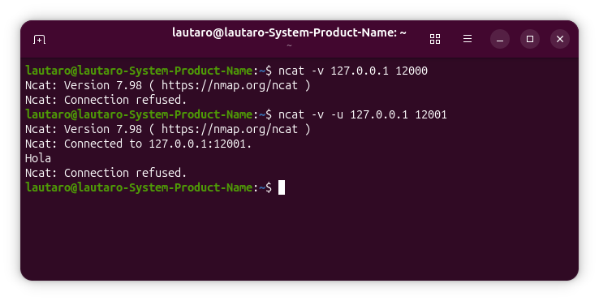
</p>

<p align="center">
  
</p>

1. **En TCP (`ncat -v 127.0.0.1 12000` con puerto cerrado):**
   - Apenas se ejecuta el comando, el cliente (`52590`) envía un segmento `[SYN]` para abrir la conexión.
   - La pila TCP del sistema operativo destino comprueba que ningún socket está en estado `LISTEN` en el puerto `12000` y responde de inmediato con un segmento con flags **`[RST, ACK]`** (*Reset*) [1].
   - **Mecanismo:** El rechazo se resuelve dentro de la **misma capa de transporte**, abortando la conexión en el acto y mostrando `Ncat: Connection refused.` en la consola.
2. **En UDP (`ncat -v -u 127.0.0.1 12001` con puerto cerrado):**
   - Al ejecutar el comando, `ncat` muestra `Ncat: Connected to 127.0.0.1:12001.` y **no se envía ningún paquete a la red** porque UDP no tiene *handshake*.
   - Recién cuando se escribe el texto (`Hola`) y se presiona `Enter`, el cliente transmite el datagrama UDP hacia el puerto `12001`.
   - Al llegar a destino, el sistema operativo comprueba que no existe ningún socket UDP asociado al puerto `12001`. Al carecer UDP de flags o paquetes de control propios, la notificación es delegada a la **capa de red**, que emite un mensaje **ICMP Destination unreachable (Port unreachable)** (Tipo 3, Código 3) [1], provocando que `ncat` imprima `Ncat: Connection refused.` y finalice el proceso.

---

## Servidor TCP mínimo

### Análisis de sockets TCP

Los scripts `TP5/src/tcp_server.py` y `TP5/src/tcp_client.py` implementan una comunicación cliente-servidor sobre TCP utilizando la API de sockets provista por el módulo `socket` de Python [1], [2], [3]. Un socket actúa como el punto final (*endpoint*) local a través del cual el proceso de usuario entrega y consume bytes, delegando en el sistema operativo la gestión de la máquina de estados de TCP, el encapsulamiento en paquetes IPv4 y la transmisión a través de la interfaz de red.

- **Funcionamiento de `tcp_server.py`:** crea un socket TCP sobre IPv4 (`servidor`), habilita la reutilización inmediata del puerto local (`SO_REUSEADDR`), lo asocia a la dirección `127.0.0.1:12000` (`bind()`) y lo coloca en estado de escucha pasiva (`listen(1)`). A continuación, se bloquea en `accept()` hasta que un cliente completa el *three-way handshake*. Cuando esto ocurre, recibe el nuevo socket dedicado a esa sesión (`conexion`) junto con la tupla `(IP, puerto)` del cliente, lee hasta 1024 bytes del flujo mediante `recv(1024)`, decodifica el mensaje en UTF-8 y envía de vuelta la cadena `"Recibido: " + mensaje` con `sendall()`. Finalmente, aguarda a que el cliente inicie el cierre ordenado consumiendo del socket en un bucle `while conexion.recv(1024): pass` hasta recibir `b""` (EOF) y libera ambos descriptores con `conexion.close()` y `servidor.close()`.
- **Funcionamiento de `tcp_client.py`:** crea su propio socket TCP sobre IPv4 (`cliente`), fija un tiempo máximo de espera de 5 segundos (`settimeout(5)`) e invoca `connect(("127.0.0.1", 12000))` para iniciar la conexión activa. Una vez completado el *handshake*, consulta el par `(IP, puerto)` efímero que le asignó el sistema operativo mediante `getsockname()`, envía el mensaje codificado en UTF-8 con `sendall()`, espera la respuesta del servidor con `recv(1024)` y cierra su extremo de la comunicación ejecutando `cliente.close()`.

#### Opciones y parámetros de configuración del socket

| Parámetro / Opción | Ubicación en el código | Función |
| :--- | :--- | :--- |
| `AF_INET` | `socket.socket(socket.AF_INET, ...)` (ambos) | Especifica la familia de direcciones de capa de red **IPv4** (direcciones de 32 bits e identificación de extremos mediante pares `(IP, puerto)`). |
| `SOCK_STREAM` | `socket.socket(..., socket.SOCK_STREAM)` (ambos) | Define un socket orientado a flujo continuo de bytes, bidireccional, confiable y orientado a conexión, implementado por el sistema operativo mediante el protocolo **TCP**. |
| `SO_REUSEADDR` | `servidor.setsockopt(socket.SOL_SOCKET, socket.SO_REUSEADDR, 1)` (servidor) | Configura a nivel de socket (`SOL_SOCKET`) la reutilización de la dirección y puerto locales (`12000`). Permite reiniciar el servidor inmediatamente sin obtener el error `Address already in use` cuando quedan conexiones previas en estado `TIME_WAIT` dentro del kernel. |
| `settimeout(5)` | `cliente.settimeout(5)` (cliente) | Establece un tiempo máximo de espera de 5 segundos para las operaciones bloqueantes del socket (`connect()`, `recv()`, `sendall()`). Si el servidor no responde dentro de ese plazo, lanza una excepción `socket.timeout` (`TimeoutError`) evitando que el proceso quede bloqueado indefinidamente. |

#### Análisis de las llamadas a la API de sockets

1. **`socket()`:** solicita al sistema operativo la creación de un nuevo descriptor de socket en memoria, especificando la familia de red (`AF_INET`) y el tipo de servicio de transporte (`SOCK_STREAM`).
2. **`bind((HOST, PORT))`:** asocia localmente el socket del servidor a la dirección IP `127.0.0.1` y al puerto TCP `12000` en la tabla de sockets del sistema operativo.
3. **`listen(1)`:** marca el socket del servidor como pasivo (estado TCP `LISTEN`) e instruye al kernel para aceptar solicitudes de conexión entrantes (`SYN`) dirigidas al puerto `12000`, encolando hasta 1 conexión pendiente de ser tomada por `accept()`.
4. **`connect((SERVER_IP, SERVER_PORT))`:** inicia de forma activa el establecimiento de la conexión desde el cliente hacia `127.0.0.1:12000`. Bloquea al proceso cliente hasta que se completa el *three-way handshake* (o hasta que falla con `ConnectionRefusedError` si recibe un `RST` o `TimeoutError` si expira el temporizador).
5. **`accept()`:** bloquea al proceso servidor hasta que la cola de conexiones completadas del socket de escucha tiene al menos una sesión en estado `ESTABLISHED`. Extrae esa conexión y devuelve un par `(conexion, direccion_cliente)`.
6. **`sendall(bytes)`:** copia los datos de la aplicación al buffer de envío de TCP en el kernel para su transmisión al extremo remoto, invocando internamente envíos sucesivos hasta asegurar que todos los bytes hayan sido entregados a la pila TCP.
7. **`recv(bufsize)`:** lee hasta `bufsize` bytes (1024 en los scripts) desde el buffer de recepción de TCP mantenido por el sistema operativo. Si aún no hay datos disponibles y la conexión sigue abierta, bloquea al proceso hasta que lleguen bytes o se cierre el flujo.
8. **`close()`:** libera el descriptor de socket del proceso e indica al kernel que no se enviarán más datos por esa conexión; en un socket conectado (`ESTABLISHED` o `CLOSE_WAIT`), esto dispara el envío de un segmento con el flag `FIN`.

#### Aspectos clave de la relación entre la API de sockets y TCP

1. **Por qué `accept()` devuelve un nuevo socket dedicado mientras el original continúa escuchando:**
   En TCP, cada conexión activa se identifica de manera única en el sistema operativo mediante la cuádrupla `(IP_local, puerto_local, IP_remota, puerto_remoto)`. El socket original (`servidor`) solo está ligado al par local `(127.0.0.1, 12000)` en estado `LISTEN`, cuya única función es recibir segmentos `SYN` de nuevos clientes. Cuando se completa el *three-way handshake*, `accept()` instancia y devuelve un socket distinto (`conexion`, en estado `ESTABLISHED`) asociado a la cuádrupla completa de ese cliente particular (`127.0.0.1:12000 ↔ 127.0.0.1:38512`). De este modo, el servidor utiliza `conexion` para intercambiar datos con ese cliente sin alterar el socket pasivo `servidor`, que permanece en estado `LISTEN` para poder aceptar conexiones adicionales en el puerto `12000` [1].

2. **Por qué `recv()` devuelve `b""` cuando el extremo remoto cierra ordenadamente su conexión:**
   Dado que TCP transporta un flujo continuo de bytes sin delimitadores de mensajes, la aplicación receptora necesita distinguir entre la ausencia temporal de datos (que hace que `recv()` aguarde bloqueado) y el fin definitivo del flujo (*End-Of-File*, EOF). Cuando el cliente invoca `cliente.close()`, su pila TCP transmite un segmento con el flag `FIN` indicando que no enviará más bytes. Al arribar este segmento `FIN` al servidor, el kernel marca el fin del flujo de entrada en el buffer de recepción y desbloquea la llamada `conexion.recv(1024)` haciendo que retorne inmediatamente la cadena de bytes vacía `b""` (0 bytes). En `tcp_server.py`, el bucle `while conexion.recv(1024): pass` utiliza este valor de retorno vacío (que se evalúa como `False` en Python) para detectar que el cliente cerró su extremo antes de proceder a cerrar el socket del lado servidor.

3. **Por qué las operaciones `socket()`, `bind()` y `listen()` no generan directamente segmentos TCP:**
   Las tres primitivas configuran únicamente estructuras de datos locales dentro del kernel del sistema operativo antes de que exista una contraparte remota:
   - `socket()` solo reserva el descriptor y la estructura interna del endpoint en memoria.
   - `bind()` registra en el sistema operativo la reserva local del par `(127.0.0.1, 12000)` verificando que no esté ocupado por otro proceso.
   - `listen()` cambia el estado local del socket a `LISTEN` y crea las colas del kernel para gestionar futuros *handshakes*.

   Como en ninguno de estos pasos se especifica una dirección de destino ni hay una conexión activa, no se transmite ningún paquete por la interfaz de red; recién a partir de `listen()` la pila TCP del kernel queda preparada para responder automáticamente con `SYN, ACK` cuando arribe un `SYN`.

4. **Qué sucede a nivel TCP cuando se ejecuta `connect()`:**
   Al ejecutarse `cliente.connect(("127.0.0.1", 12000))`, el sistema operativo del cliente:
   - Selecciona automáticamente una dirección IP local (`127.0.0.1`) y un **puerto efímero** libre (`38512` en la prueba realizada), además de generar un número de secuencia inicial (`ISN`).
   - Envía el primer segmento del *three-way handshake* con el flag `SYN` activado hacia `127.0.0.1:12000` y coloca el socket en estado `SYN_SENT`.
   - Al recibir la respuesta `SYN, ACK` generada por el kernel del servidor, la pila TCP del cliente valida el acuse de recibo (`Ack = ISN_cliente + 1`), envía el tercer segmento con el flag `ACK` (`Ack = ISN_servidor + 1`) y pasa el socket al estado `ESTABLISHED`.
   - Recién cuando se envía ese `ACK` final, `connect()` retorna el control al script `tcp_client.py` (y, al llegar dicho `ACK` al servidor, el kernel desbloquea `accept()` en `tcp_server.py`).

---

### Ejecución e inspección en Loopback

Se inició la captura en **Wireshark** sobre la interfaz de loopback (`lo`) aplicando el filtro de visualización:

```text
tcp.port == 12000
```

Con la captura activa, se ejecutó primero el servidor en la Terminal A y a continuación el cliente en la Terminal B:

```bash
# Terminal A (Servidor)
python3 TP5/src/tcp_server.py

# Terminal B (Cliente)
python3 TP5/src/tcp_client.py 127.0.0.1 "Hola desde mi programa"
```

#### Salidas obtenidas en las terminales

**Terminal A (`tcp_server.py`):**

```text
[servidor TCP] escuchando en 127.0.0.1:12000 ...
[servidor TCP] conexión aceptada desde 127.0.0.1:38512
[servidor TCP] recibido (22 bytes): 'Hola desde mi programa'
[servidor TCP] respuesta enviada: 'Recibido: Hola desde mi programa'
[servidor TCP] el cliente cerró la conexión
```

**Terminal B (`tcp_client.py`):**

```text
[cliente TCP] conectado a 127.0.0.1:12000 desde 127.0.0.1:38512
[cliente TCP] enviado: 'Hola desde mi programa'
[cliente TCP] respuesta (32 bytes): 'Recibido: Hola desde mi programa'
```

A partir de las salidas registradas se identifican los parámetros de la sesión:

- **Dirección y puerto del servidor:** `127.0.0.1:12000` (fijado explícitamente con `bind()`).
- **Dirección y puerto efímero del cliente:** `127.0.0.1:38512` (asignado dinámicamente por el sistema operativo al invocar `connect()`, observado en el cliente mediante `getsockname()` y en el servidor a través de la tupla devuelta por `accept()`).
- **Bytes transmitidos del cliente al servidor:** **22 bytes**, correspondientes a la codificación UTF-8 de la cadena `'Hola desde mi programa'` (22 caracteres ASCII de 1 byte cada uno).
- **Bytes transmitidos del servidor al cliente:** **32 bytes**, correspondientes a la cadena `'Recibido: Hola desde mi programa'` (los 10 bytes del prefijo `'Recibido: '` sumados a los 22 bytes del mensaje recibido).

#### Inspección del tráfico capturado en Wireshark

Al aplicar el filtro `tcp.port == 12000`, se registraron exactamente **10 segmentos TCP** (paquetes `1` a `10`) que abarcan el ciclo completo de la conexión:

<p align="center">
  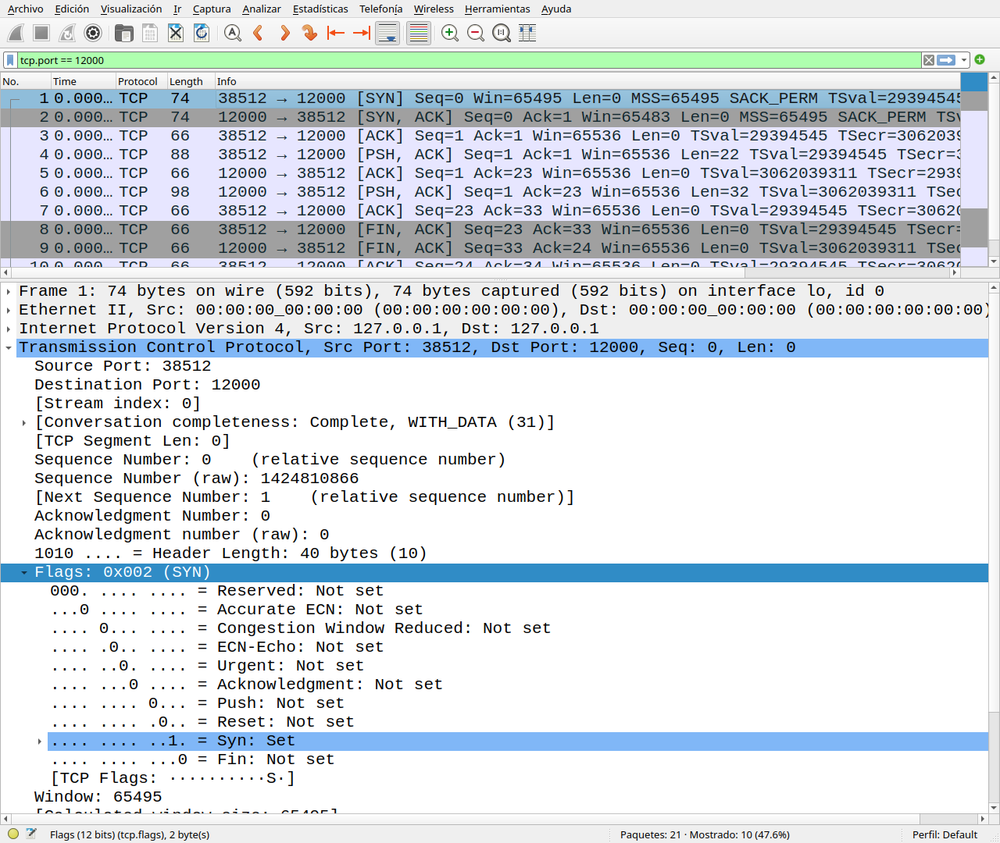
</p>

| N.º Paquete | Origen | Destino | Flags TCP | Seq (rel.) | Ack (rel.) | Len (payload) | Etapa de la comunicación |
| :--- | :--- | :--- | :--- | :--- | :--- | :--- | :--- |
| **1** | `127.0.0.1:38512` | `127.0.0.1:12000` | `[SYN]` (`0x002`) | `0` | — | `0 B` | Inicio del *three-way handshake* (cliente → servidor) |
| **2** | `127.0.0.1:12000` | `127.0.0.1:38512` | `[SYN, ACK]` (`0x012`) | `0` | `1` | `0 B` | Respuesta del *three-way handshake* (servidor → cliente) |
| **3** | `127.0.0.1:38512` | `127.0.0.1:12000` | `[ACK]` (`0x010`) | `1` | `1` | `0 B` | Confirmación del *three-way handshake* (cliente → servidor) |
| **4** | `127.0.0.1:38512` | `127.0.0.1:12000` | `[PSH, ACK]` (`0x018`) | `1` | `1` | `22 B` | Envío del mensaje `'Hola desde mi programa'` |
| **5** | `127.0.0.1:12000` | `127.0.0.1:38512` | `[ACK]` (`0x010`) | `1` | `23` | `0 B` | Confirmación TCP de los 22 bytes recibidos por el servidor |
| **6** | `127.0.0.1:12000` | `127.0.0.1:38512` | `[PSH, ACK]` (`0x018`) | `1` | `23` | `32 B` | Envío de la respuesta `'Recibido: Hola desde mi programa'` |
| **7** | `127.0.0.1:38512` | `127.0.0.1:12000` | `[ACK]` (`0x010`) | `23` | `33` | `0 B` | Confirmación TCP de los 32 bytes recibidos por el cliente |
| **8** | `127.0.0.1:38512` | `127.0.0.1:12000` | `[FIN, ACK]` (`0x011`) | `23` | `33` | `0 B` | Solicitud de cierre iniciada por el cliente |
| **9** | `127.0.0.1:12000` | `127.0.0.1:38512` | `[FIN, ACK]` (`0x011`) | `33` | `24` | `0 B` | Confirmación del `FIN` del cliente y cierre del servidor |
| **10** | `127.0.0.1:38512` | `127.0.0.1:12000` | `[ACK]` (`0x010`) | `24` | `34` | `0 B` | Confirmación final del cierre por parte del cliente |

A continuación se detalla cada fase observada en las capturas:

1. **Establecimiento de la conexión (*three-way handshake*, paquetes 1 a 3):**
   - **Paquete 1 (`[SYN]`):** el cliente (`38512`) envía un segmento con el flag `SYN` activado (`Flags: 0x002`), número de secuencia inicial relativo `Seq=0` (*raw* `1424810866`), `Len=0` y opciones de negociación (`MSS=65495`, `SACK_PERM`, `WS=1024`) hacia el puerto `12000` (visible en la captura general).
   - **Paquete 2 (`[SYN, ACK]`):** el kernel del servidor (`12000`) responde al puerto `38512` con los flags `SYN` y `ACK` activados (`Flags: 0x012`), anunciando su propio número de secuencia inicial `Seq=0` (*raw* `3312352991`) y confirmando el `SYN` del cliente con `Ack=1` (*raw* `1424810867`).
   - **Paquete 3 (`[ACK]`):** el cliente (`38512`) completa el *handshake* enviando un segmento con el flag `ACK` (`Flags: 0x010`), `Seq=1`, `Ack=1` y `Len=0`. En este punto la conexión queda establecida en ambos extremos.

   <p align="center">
     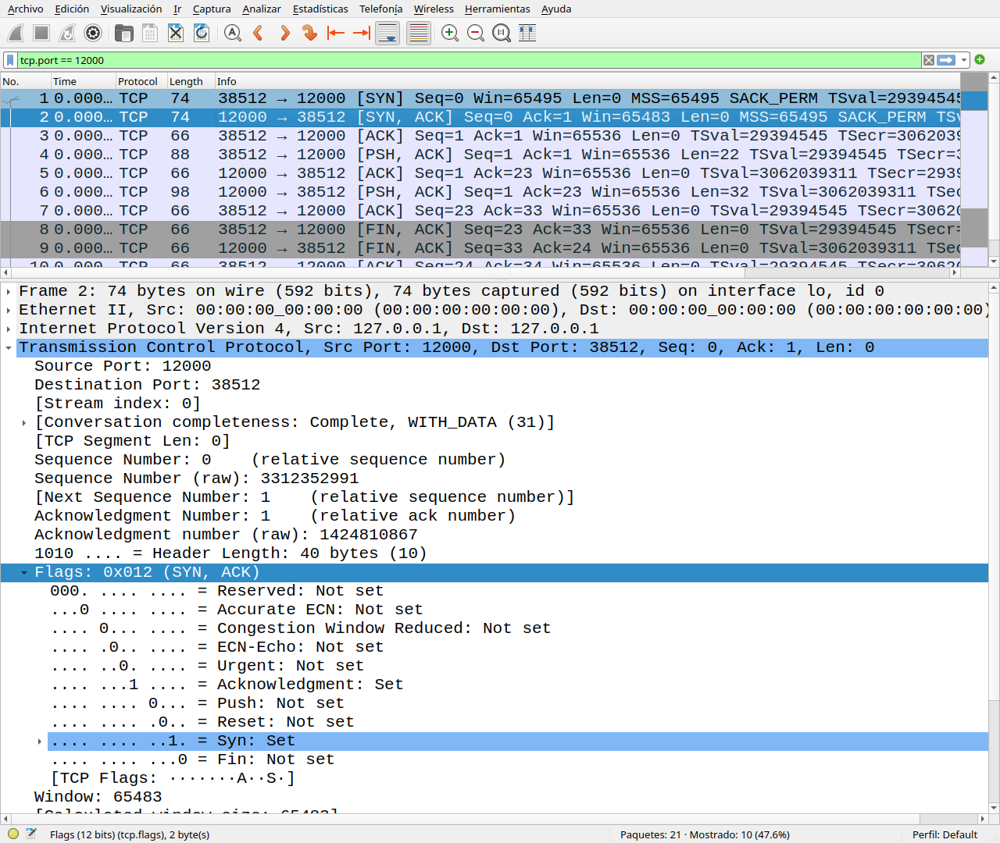
   </p>

   <p align="center">
     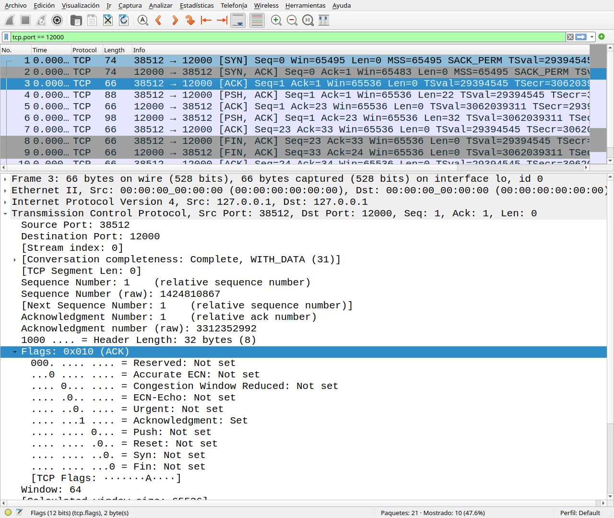
   </p>

2. **Transmisión del mensaje del cliente al servidor (paquetes 4 y 5):**
   - **Paquete 4 (`[PSH, ACK]`):** el cliente transmite desde el puerto `38512` al `12000` un segmento con `Flags: 0x018 (PSH, ACK)`, `Seq=1`, `Ack=1` y una carga útil de `TCP Segment Len: 22` (longitud total de trama de 88 bytes en `lo`). En el panel de detalles y en el volcado hexadecimal/ASCII se observa el campo `Data (22 bytes)` con los bytes `48 6f 6c 61 20 64 65 73 64 65 20 6d 69 20 70 72 6f 67 72 61 6d 61`, correspondientes al texto `'Hola desde mi programa'`. El flag `PSH` solicita que la pila receptora entregue los datos de inmediato a la aplicación.
   - **Paquete 5 (`[ACK]`):** la pila TCP del servidor (`12000 → 38512`) confirma automáticamente la recepción de los 22 bytes enviando un segmento con `Flags: 0x010 (ACK)`, `Seq=1`, `Ack=23` (`1 + 22`) y `Len=0`.

   <p align="center">
     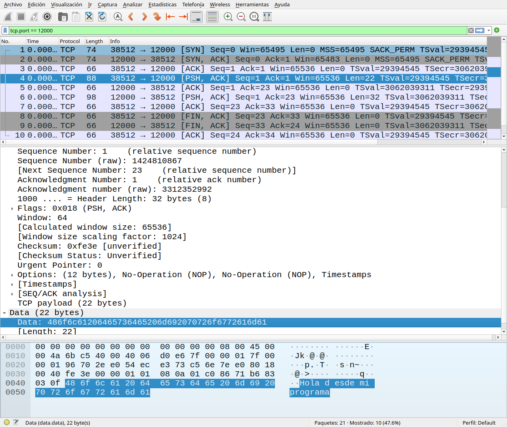
   </p>

   <p align="center">
     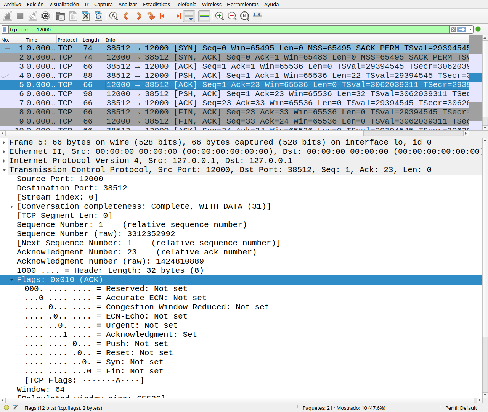
   </p>

3. **Respuesta del servidor al cliente (paquetes 6 y 7):**
   - **Paquete 6 (`[PSH, ACK]`):** el servidor transmite desde el puerto `12000` hacia el `38512` un segmento con `Flags: 0x018 (PSH, ACK)`, `Seq=1`, `Ack=23` y `TCP Segment Len: 32` (98 bytes totales en `lo`). El campo `Data (32 bytes)` contiene la cadena `'Recibido: Hola desde mi programa'` (`52 65 63 69 62 69 64 6f 3a 20 ...`).
   - **Paquete 7 (`[ACK]`):** el kernel del cliente (`38512 → 12000`) confirma los 32 bytes recibidos mediante un segmento con `Flags: 0x010 (ACK)`, `Seq=23`, `Ack=33` (`1 + 32`) y `Len=0`.

   <p align="center">
     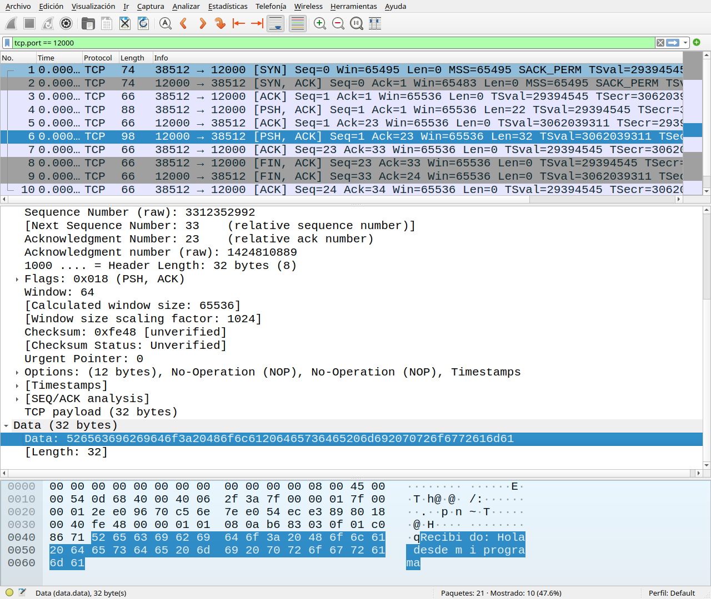
   </p>

   <p align="center">
     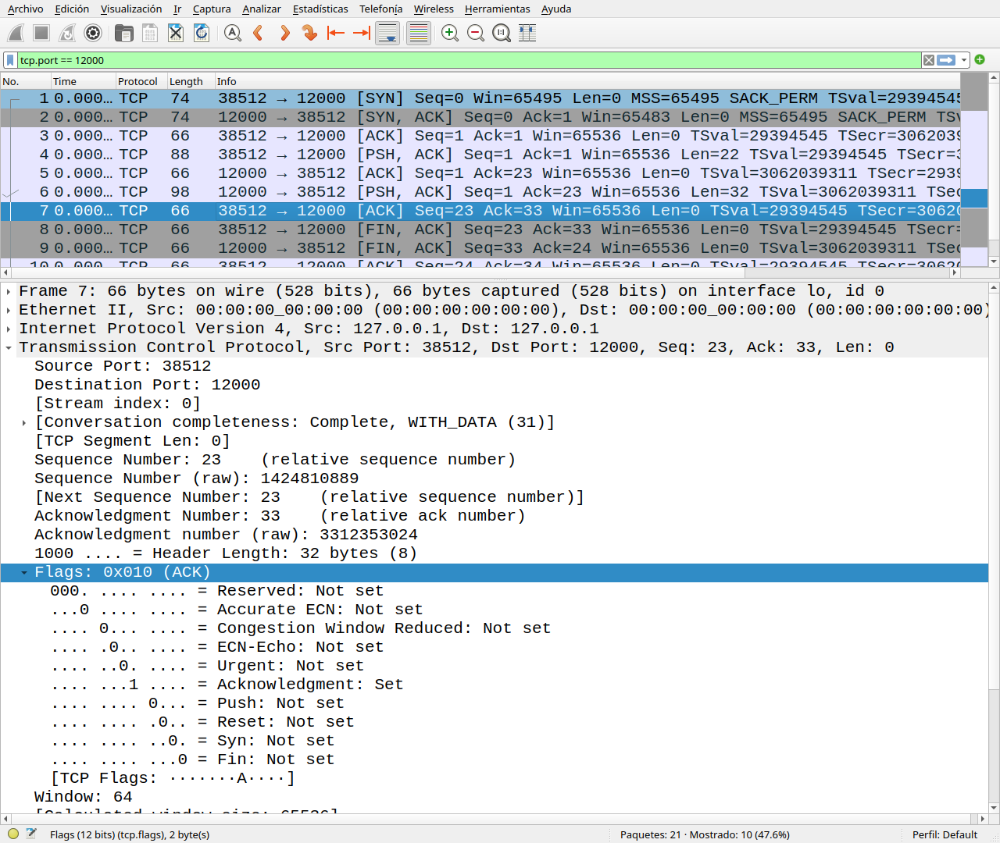
   </p>

4. **Cierre de la conexión TCP (paquetes 8 a 10):**
   - **Paquete 8 (`[FIN, ACK]`):** al ejecutarse `cliente.close()`, el cliente (`38512 → 12000`) inicia el cierre activo enviando un segmento con `Flags: 0x011 (FIN, ACK)`, `Seq=23`, `Ack=33` y `Len=0`.
   - **Paquete 9 (`[FIN, ACK]`):** la llegada del `FIN` del cliente hace que `conexion.recv(1024)` en el servidor retorne `b""`, saliendo del bucle `while` y ejecutando inmediatamente `conexion.close()`. Debido a que el cierre del servidor ocurre de forma inmediata en loopback, el kernel del servidor combina en un solo segmento (`12000 → 38512`) el acuse del `FIN` del cliente (`Ack=24`, ya que el flag `FIN` consume un número de secuencia) y su propio indicador de finalización (`Seq=33`, `Flags: 0x011 (FIN, ACK)`).
   - **Paquete 10 (`[ACK]`):** el kernel del cliente (`38512 → 12000`) envía la confirmación final con `Flags: 0x010 (ACK)`, `Seq=24`, `Ack=34` (`33 + 1`) y `Len=0`, dando por concluido el cierre de la conexión.

   <p align="center">
     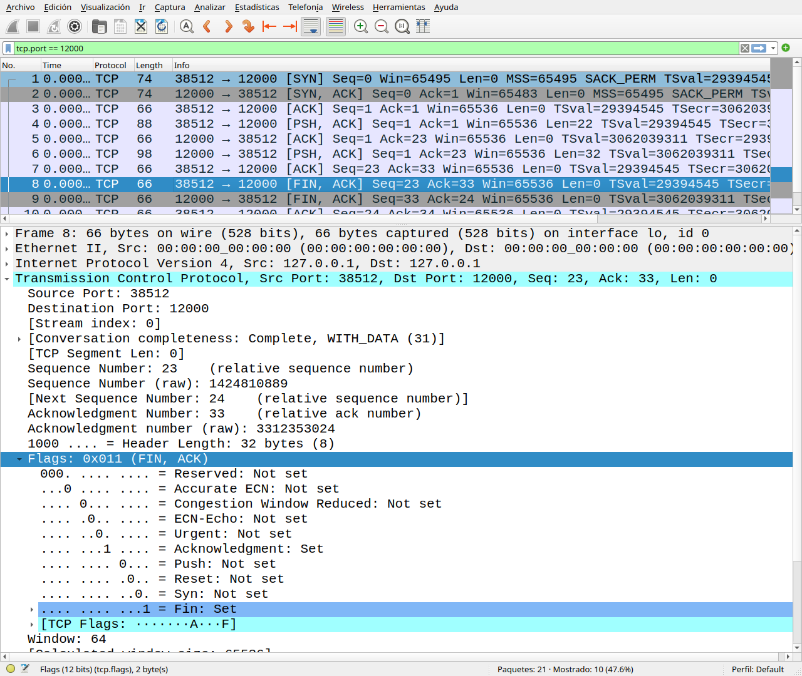
   </p>

   <p align="center">
     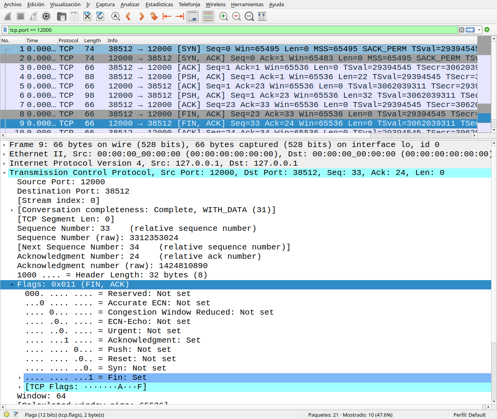
   </p>

   <p align="center">
     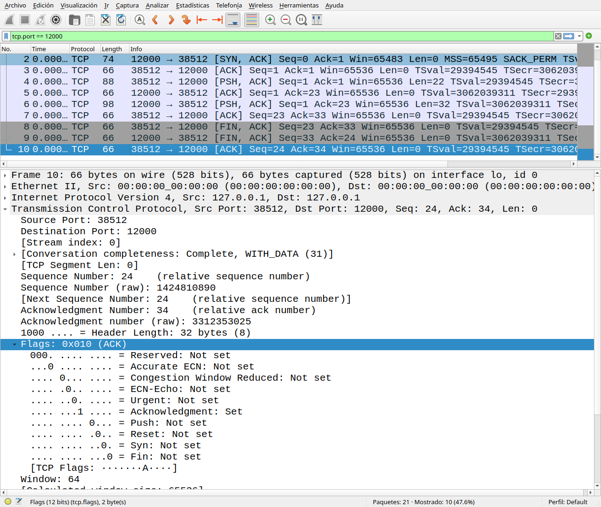
   </p>

---

### Tabla de primitivas de sockets vs. tráfico de red

La siguiente tabla relaciona cada llamada a la API de sockets presente en `tcp_server.py` y `tcp_client.py` con su ubicación de ejecución, su comportamiento respecto a la red y los segmentos observados en la captura [3]:

| Llamada | ¿Dónde se ejecuta? | ¿Genera tráfico? | Segmentos observados |
| :--- | :--- | :--- | :--- |
| `socket()` | Ambos (servidor y cliente) | No (operación local del SO) | Ninguno. Reserva localmente el descriptor y la estructura del socket en el kernel. |
| `bind()` | Servidor | No (operación local del SO) | Ninguno. Asocia localmente el socket a `127.0.0.1:12000`. |
| `listen()` | Servidor | No (operación local del SO) | Ninguno al ejecutarse. Pone el socket en estado `LISTEN`, habilitando al kernel del servidor para responder con el **Paquete 2** (`[SYN, ACK]`) cuando arriba un `[SYN]`. |
| `connect()` | Cliente | Sí | **Paquete 1** (`38512 → 12000`, `[SYN]`) enviado por el cliente; desencadena el **Paquete 2** (`12000 → 38512`, `[SYN, ACK]`) del kernel del servidor y el **Paquete 3** (`38512 → 12000`, `[ACK]`) del cliente que completa el *three-way handshake*. |
| `accept()` | Servidor | No (operación local del SO) | Ninguno generado directamente. Permanece bloqueada y retorna el nuevo socket `conexion` (`127.0.0.1:12000 ↔ 127.0.0.1:38512`) una vez que el kernel recibe el **Paquete 3** (`[ACK]`) que completa el *handshake*. |
| `sendall()` | Ambos (cliente y servidor) | Sí | En el cliente (`cliente.sendall()`): **Paquete 4** (`38512 → 12000`, `[PSH, ACK]`, `Len=22`). En el servidor (`conexion.sendall()`): **Paquete 6** (`12000 → 38512`, `[PSH, ACK]`, `Len=32`). *(Nota: los acuses **Paquete 5** `[ACK]` y **Paquete 7** `[ACK]` los envía automáticamente la pila TCP del extremo receptor al recibir los paquetes 4 y 6).* |
| `recv()` | Ambos (servidor y cliente) | No (operación local del SO) | Ninguno. Consume datos que ya fueron recibidos, confirmados y almacenados en el buffer de recepción del SO: en el servidor extrae los 22 bytes del **Paquete 4** (y en el bucle final retorna `b""` al haberse recibido el **Paquete 8** `[FIN, ACK]`); en el cliente extrae los 32 bytes del **Paquete 6**. |
| `close()` | Ambos (cliente y servidor) | Sí (en sockets conectados) / No (en el socket de escucha) | En el cliente (`cliente.close()`): genera el **Paquete 8** (`38512 → 12000`, `[FIN, ACK]`). En el servidor (`conexion.close()`): genera el **Paquete 9** (`12000 → 38512`, `[FIN, ACK]`), que es confirmado automáticamente por el kernel del cliente con el **Paquete 10** (`38512 → 12000`, `[ACK]`). El cierre del socket pasivo (`servidor.close()`) es una operación local que libera el puerto `12000` sin emitir segmentos. |

Como se observa en la tabla, no existe una relación uno a uno entre las llamadas a la API y los segmentos TCP en la red:

- Las primitivas de configuración inicial (`socket()`, `bind()`, `listen()`) y de lectura o desencolado (`accept()`, `recv()`) operan sobre estructuras y buffers locales del kernel sin transmitir paquetes propios.
- Los segmentos de confirmación pura (**Paquete 5** `[ACK]`, **Paquete 7** `[ACK]` y **Paquete 10** `[ACK]`) así como la respuesta **Paquete 2** (`[SYN, ACK]`) son emitidos de forma autónoma por la pila TCP del sistema operativo al procesar segmentos entrantes, independientemente del instante en que el proceso de usuario invoque `recv()` o `accept()`.
- Una llamada a `sendall()` entrega un bloque de bytes al buffer de salida de TCP; aunque en esta experiencia cada mensaje pequeño (22 y 32 bytes) viajó en un único segmento `[PSH, ACK]`, para volúmenes de datos mayores la pila TCP puede fragmentar el flujo en múltiples segmentos o agrupar escrituras sucesivas según el MSS y la ventana disponible.

---

## Conclusión

El trabajo permitió recorrer la pila TCP/IP desde abajo hacia arriba, observando en capturas reales cómo cada protocolo se apoya en el anterior. Con **ICMP** y `ping` se identificaron las capas Ethernet II, IPv4 e ICMP de un mismo paquete y se comprobó que la dirección MAC tiene alcance local mientras que la IP se mantiene de extremo a extremo: la trama dirigida a 8.8.8.8 llevaba como destino la MAC del router, y el TTL de la respuesta permitió estimar la cantidad de saltos recorridos.

Con **ARP** se observó el mecanismo que conecta ambas direcciones. El Request viaja en broadcast porque busca una MAC desconocida y el Reply vuelve en unicast; la caché evita repetir esa consulta, y cuando la IP no existe ningún paquete IP llega a salir, porque sin MAC no es posible armar la trama. También quedó en evidencia que la falta de autenticación de ARP lo hace vulnerable a ataques de suplantación.

En la capa de transporte, los experimentos con `ncat` mostraron el costo y el beneficio de cada protocolo. Para las mismas 6 frases, **TCP** necesitó 18 segmentos (*handshake*, datos con su confirmación y cierre ordenado) frente a 6 datagramas de **UDP**, que no establece conexión, no confirma la entrega y no avisa al cerrar. Ante un puerto cerrado, TCP rechaza la conexión con un `RST`, mientras que UDP depende de un mensaje ICMP *Port Unreachable*. Finalmente, el servidor TCP mínimo en Python permitió correlacionar cada llamada de la API de sockets con el tráfico observado: `socket()`, `bind()`, `listen()`, `accept()` y `recv()` son operaciones locales del sistema operativo, mientras que `connect()`, `sendall()` y `close()` disparan los segmentos del *handshake*, de los datos y del cierre. En síntesis, se verificó que la comunicación entre aplicaciones descansa en una serie de mecanismos de red que el sistema operativo resuelve de forma transparente para el programador.

---

## Referencias

[1] James F. Kurose y Keith W. Ross, Redes de computadoras: Un enfoque descendente, 7.ª edición, capítulos 2 “La capa de aplicación”, sección 2.7.2 “Programación de sockets con TCP”; 3 “La capa de transporte”, secciones 3.3.1 “Estructura de los segmentos UDP”, 3.5.2 “Estructura del segmento TCP” y 3.5.6 “Gestión de la conexión TCP”; 5 “La capa de red: el plano de control”, sección 5.6 “Protocolo de mensajes de control de Internet (ICMP)”; y 6 “La capa de enlace y las redes de área local”, sección 6.4.1 “Direccionamiento de la capa de enlace y ARP”.

[2] Douglas E. Comer, Internetworking with TCP/IP Volume One: Principles, Protocols, and Architecture, 6.ª edición, capítulos 6 “Mapping Internet Addresses To Physical Addresses (ARP)”, 9 “Internet Protocol: Error And Control Messages (ICMP)” y 21 “The Socket API”.

[3] Andrew S. Tanenbaum, Redes de computadoras, 4.ª edición, capítulos 5 “La capa de red”, sección 5.6.3 “Protocolos de Control en Internet”; y 6 “La capa de transporte”, secciones 6.1.3 “Sockets de Berkeley”, 6.2.1 “Direccionamiento” y 6.5.5 “Establecimiento de una conexión TCP”.

[4] J. Postel, RFC 792: Internet Control Message Protocol, IETF, 1981. https://www.rfc-editor.org/rfc/rfc792

[5] J. Postel, RFC 791: Internet Protocol, IETF, 1981. https://www.rfc-editor.org/rfc/rfc791

[6] Wireshark Foundation, Wireshark User's Guide: Building Display Filter Expressions. https://www.wireshark.org/docs/wsug_html_chunked/ChWorkBuildDisplayFilterSection.html

[7] ping(8), manual de iputils. https://man7.org/linux/man-pages/man8/ping.8.html
